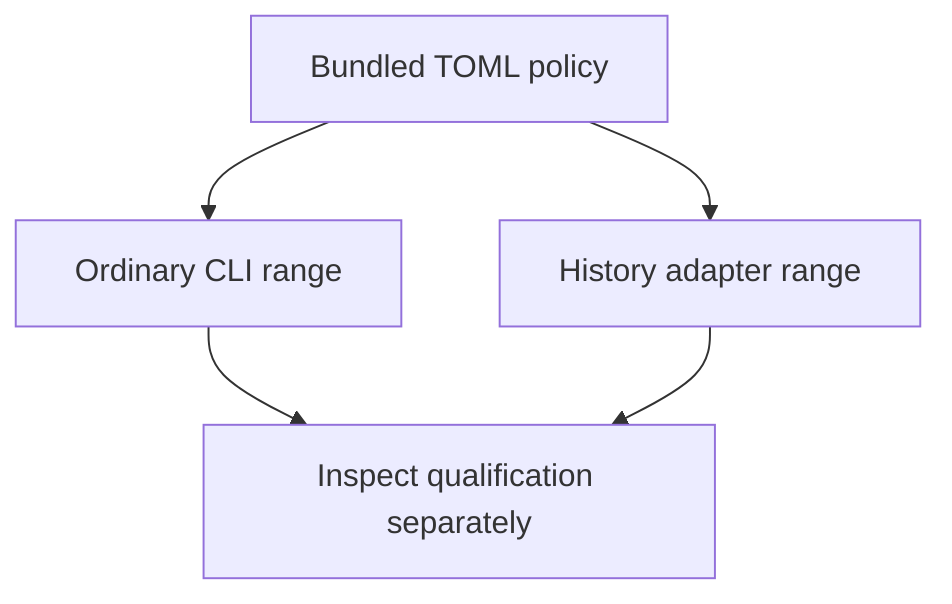

# Inspect bundled provider policy offline

Compare ordinary CLI compatibility with the narrower history-adapter policy without installing or starting a provider.

## Follow the SDK boundary



Installation recommendations and history adapter qualification come from different bundled policy records. The excerpt below is from the runnable script; its setup and surrounding checks remain in that script.

```python
root = files("agent_manager").joinpath("providers")
general = tomllib.loads(root.joinpath("provider-policy.toml").read_text())
terminal = tomllib.loads(root.joinpath("terminal-policy.toml").read_text())
for provider, row in terminal["providers"].items():
    adapter = row.get("continuation")
```

Continue with [an authenticated worker and reviewer](../../../docs/examples/connected/live-review.md) to connect this boundary to Carrier delivery, Undercurrent execution and a checked application result.

## Run the snapshot

Use Python 3.11+ with `aixand-agent-manager` installed. From the package directory:

```sh
python examples/policy_snapshot.py
```

Alternatively save [policy_snapshot.py](../../examples/policy_snapshot.py) and run it locally. The script prints one JSON record per bundled provider. It reads the installed package's TOML resources; it does not query a registry or vendor service. No cleanup is needed.

## Interpret the result

`installation` is the managed installation recommendation. `general_range` describes ordinary compatibility. `continuation_range` can be narrower or null. `verification` preserves partial, pending, and offline-only qualification status.

For example, the captured source recommends OpenCode 2.2.5 for installation but allows cross-environment copying only on 2.0.18. The 2.2.5 disposable import probe overwrote an existing session. A general compatible release is therefore insufficient to authorize history transfer.

Your installed snapshot may differ. Compare its output with [provider versions](../provider-versions.md), [terminal policy](../../agent_manager/providers/terminal-policy.toml), and [general policy](../../agent_manager/providers/provider-policy.toml) before upgrading a continuation workflow. This example checks policy data, not native runtime safety.
