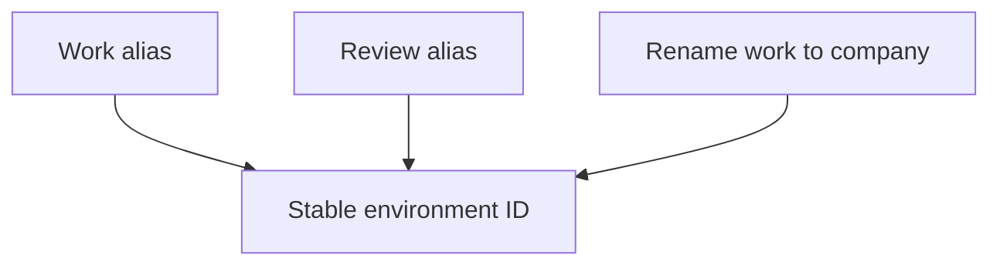

# Inspect profile identity without a provider

Run a temporary profile walkthrough without native login, a provider executable, or Undercurrent. It creates aliases, renames the default, and resolves the immutable environment target.

## Follow the SDK boundary



Aliases resolve to one immutable environment; renaming changes the name while preserving that target. The excerpt below is from the runnable script; its setup and surrounding checks remain in that script.

```python
original = manager.new_profile("work")
manager.alias_profile("review", "work")
manager.set_default("work")
manager.rename("work", "company")
target = manager.resolve_agent_target(original["environment_id"])
assert manager.home("review") == manager.home("company")
assert manager.resolve_profile() == "company"
assert target["environment_id"] == original["environment_id"]
```

Continue with [the native mailbox using explicit execution identities](../../../docs/examples/connected/agent-mailbox.md) to connect this boundary to Carrier delivery, Undercurrent execution and a checked application result.

## Run and check

Use an environment with `aixand-agent-manager` installed. From the package directory:

```sh
python examples/profile_identity.py
```

Or save [profile_identity.py](../../examples/profile_identity.py) and run it from any directory. Expect:

```text
Aliases share one stable environment; rename preserves the default.
Temporary store removed; no provider process or login was used.
```

The example uses an explicit empty configuration and isolated temporary registry. Context exit removes the temporary store, including on assertion failure. An assertion failure indicates that the installed package differs from this example's identity contract; inspect [profiles and environments](../profiles-and-environments.md) and the installed version.
