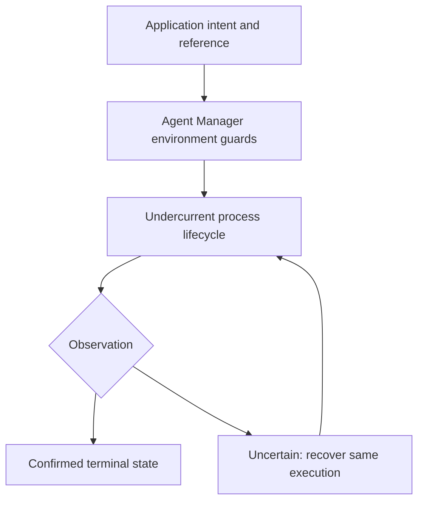

# Observe, stop, and recover native execution

Recover the exact terminal execution after detachment, cancellation, or a lost reply. This is distinct from continuing saved conversation history.

## Understand the ownership boundary



| State or operation | Owner |
| --- | --- |
| Durable launch UUID, task acceptance | Application |
| Profile/environment selection and native history guards | Agent Manager |
| Runtime session, terminal input/output, termination | Undercurrent |
| Native history and authentication | Provider |

A runtime acknowledgement is not provider readiness. An input receipt proves delivery only. An available or quiescent terminal does not establish that a task succeeded.

## Recover an exact execution

Persist `agent.reference.to_dict()` privately. Reconnect with the same provider registry and original Undercurrent home, then call `await agents.get(reference)`. Recovery validates the recorded run and exact session; it does not start a replacement.

If no reference was received, reuse the retained launch UUID and identical arguments. Inspect the retained run or reconcile it before considering replacement work. Cancellation and timeouts do not prove that dispatch had no effect. Closing a Client or borrowed runtime only detaches.

See the [persistent execution example](../../docs/examples/persistent-agents.md) for a utility that saves launch intent before dispatch.

## Read output without skipping bytes

Within a connected handle context:

```python
page = await agent.read_output(from_offset=offset, max_bytes=65536)
offset = page.from_offset + len(page.data)
```

Do not advance to the producer's `next_offset`, which can exceed the returned page. Handle output gaps, event gaps, and watch resynchronization explicitly. Close early-exit async streams with `contextlib.aclosing`. Screen bytes may contain terminal escapes and truncated content.

## Stop and verify

For a managed SDK handle:

```python
await agent.stop(graceful_only=True)
await agent.wait(lifecycle=('stopped', 'exited', 'failed'), timeout=30)
```

A stop request can return while termination remains pending. A timeout leaves the outcome uncertain. Observe the original runtime again; unknown observations retain execution leases. Reconciliation releases guards only after terminal or absence evidence from the original runtime.

For a native Codex session on Linux, `agent codex stop SESSION_REFERENCE` verifies the writer identity, sends SIGTERM, and waits up to ten seconds for lock release. It preserves history and never deletes lock files. Other providers/platforms do not share this CLI stop contract. Exit standalone vendor sessions before cross-environment handoff.

## Diagnose retained guards

| Symptom | Next action |
| --- | --- |
| Reference belongs to another runtime home | Reconnect to the original runtime home |
| Lost launch response | Retry the retained key and unchanged intent |
| Busy native history | Inspect and stop the verified original writer |
| Runtime unavailable or state unknown | Restore observation; keep leases and evidence |
| Alias was renamed or removed | Recover by immutable execution/environment identity |

Owning sources: [SDK](../agent_manager/interfaces/sdk.py), [handle validation](../agent_manager/runtime/handle.py), [native stop](../agent_manager/runtime/native/session_stop.py), [stop tests](../tests/test_session_stop.py), and [execution tests](../tests/test_execution_sdk.py). Full fields and errors remain in the [SDK v1 contract](sdk-contract-v1.md).
