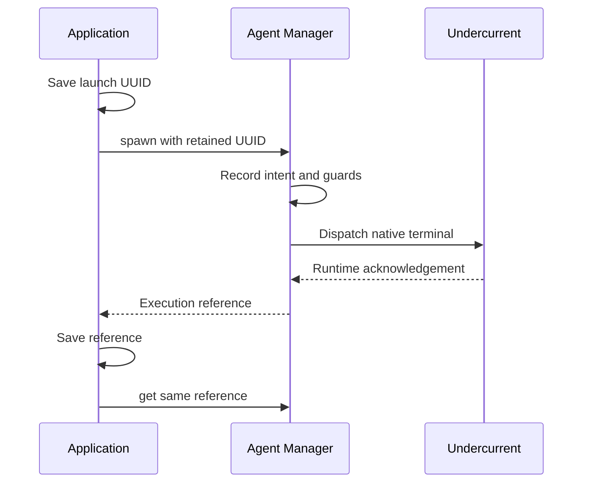

# Integrate native execution through the SDK

Use synchronous `Manager` for administration and async `Client` for managed native terminals. Use Conversation Manager for programmatic chat and approvals.

## Prepare the runtime

Install `aixand-agent-manager[sdk]` into your application environment and provide the Undercurrent binaries and daemon. SDK execution always requires Undercurrent. The CLI's `runtime = "direct"` preference does not provide an SDK subprocess mode.

```python
from agent_manager import Manager
manager = Manager('codex')
print(manager.agent_targets())
```

Target discovery is administration: it does not start a native provider. Use immutable environment UUIDs for integrations that must survive alias changes.

## Choose one execution path

| Need | SDK call | Retain |
| --- | --- | --- |
| Launch an explicit profile | `spawn(profile=..., cwd=...)` | UUID before dispatch; returned reference |
| Select an account automatically | `start(cwd=...)` | UUID and selection evidence |
| Recover an existing execution | `get(reference)` | Exact registry and original runtime home |
| Discover saved history | `sessions(cwd=...)` | Structured session `ref` |
| Continue native history | `continue_session(ref, profile=...)` | New launch UUID and execution reference |

A saved session, an Agent Manager run, and an Undercurrent process session are separate identities. Do not interchange their IDs. Discovery defaults exclude archived and child sessions; recursive workspace discovery requires a `cwd`.



An acknowledgement is not readiness. A lost reply requires recovery with the same key and arguments. Changed arguments conflict; cancellation does not authorize replacement execution.

## Observe and close deliberately

Handles expose independent lifecycle, execution, interaction, constraint, and health axes. Wait for explicit conditions; no axis proves task completion. Input receipts confirm terminal delivery only.

Closing Client detaches without stopping processes. A borrowed runtime connection remains caller-owned. Stop explicitly and observe terminal evidence before cleanup. [Execution recovery](execution-recovery.md) covers uncertain outcomes and output offsets.

Follow the shared [persistent execution](../../docs/examples/persistent-agents.md) and [two-reviewer workflow](../../docs/examples/parallel-reviews.md) for retained launch UUIDs, delivery IDs, trust prompts, evidence collection, and explicit cleanup. Separate aliases do not isolate native homes or accounts.

For signatures, serialization, retry rules, qualification commands, and error contracts, read the retained [SDK v1 specification](sdk-contract-v1.md) and [detailed SDK guide](python-sdk.md). Implementation lives in the [Client facade](../agent_manager/interfaces/sdk.py) and [execution handle](../agent_manager/runtime/handle.py). Carrier orchestration remains external.
