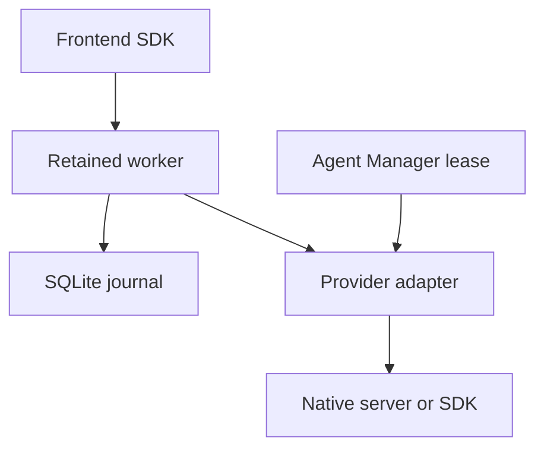

# Understand conversation ownership

Use this map to decide which layer should own a frontend feature or recovery action.

| Owner | Responsibility | Definition |
| --- | --- | --- |
| Frontend | Persist references and operation IDs; render observed outcomes | [Client](../src/conversation_manager/client.py) |
| Worker core | Active turns, requests, normalized events, mutation admission | [Core](../src/conversation_manager/core.py) |
| Store | Local references, receipts, observed history, queues | [Store](../src/conversation_manager/store.py) |
| Adapter | Native protocol, settings, resource delivery, capability report | [Registry](../src/conversation_manager/adapters/registry.py) |
| Agent Manager | Installation, profiles, authentication, native environment leases | [Public boundary](../src/conversation_manager/agents.py) |
| Runtime owner | Start, inspect and stop the worker process tree | [Runtime](../src/conversation_manager/runtime.py) |

One worker can serve several OpenCode sessions. Shared Codex mode instead retains
one worker and native connection per chat while pooling a compatible native server.
A session, connection, native server and frontend handle are different identities.

## Choose an integration level

Use `ConversationClient` for discovery, startup and attachment. Use
`PreparedLaunch`, `StandaloneLauncher`, `WorkerLauncher` and connection/session
APIs only when the application owns explicit launch inputs. Launch descriptors
carry protocol, transport, argv, cwd, settings and transient environment inputs.

A frontend detach leaves the worker and its lease running. Native TUI execution
through Agent Manager/Undercurrent is a separate surface; it does not imply
attachment to this chat process. See [worker ownership](runtime.md),
[provider boundaries](integrations.md), and [Codex sharing](codex-server-sharing.md).

## Compatibility is observed

`native_startup_support(provider)` reports implemented local startup on Linux,
macOS and Windows for Codex and OpenCode. It does not test executable availability,
sign-in or model entitlement. Shared Codex mode is disabled on Windows; the
Undercurrent path has a narrower local POSIX scope. Actual native qualification
remains separate from implemented support and offline fixture tests.

The send API accepts text and text blocks. ACP, standalone model discovery,
images/files, history search, message editing and generalized branching are
outside the current contract. Additional operations require capability checks.
See [support implementation](../src/conversation_manager/support.py),
[capability construction](../src/conversation_manager/core.py), and
[live qualification](live-qualification.md).
