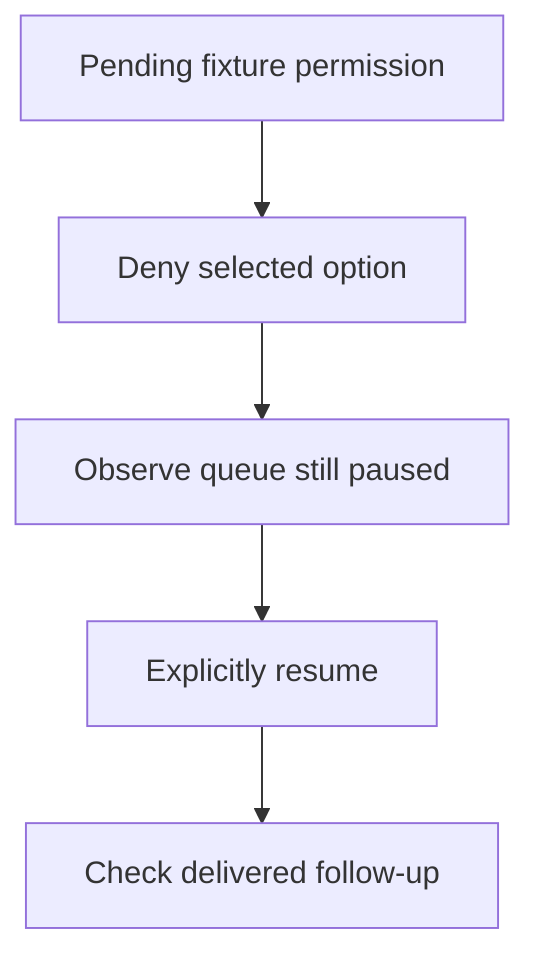

# Verify offline approvals and queue recovery

Deny a fixture permission, confirm that answering leaves the queue paused, explicitly resume, then verify idle model-setting readback.

## Follow the SDK boundary



Resolving an approval and resuming queued work are separate SDK operations. The excerpt below is from the runnable script; its setup and surrounding checks remain in that script.

```python
await chat.respond(request['request_id'],
    {'outcome': 'selected', 'option_id': 'deny_once'}, operation_id='deny')
await until(chat.state, lambda state: state['active_turn'] is None)
result = await chat.turn_result(turn)
assert result['status'] == 'completed', result
state = await chat.queue_state()
assert state['paused'] and state['items'][0]['status'] == 'queued', state
resumed = await chat.resume_queue(operation_id='resume')
assert resumed['status'] == 'completed', resumed
```

Continue with [a retained conversation dispatched from Carrier](../../../docs/examples/connected/conversation-jobs.md) to connect this boundary to Carrier delivery, Undercurrent execution and a checked application result.

## Prerequisites and execution

Use Python 3.11–3.14 and an installed `aixand-conversation-manager` package.
From `conversation-manager/`, run:

```sh
python examples/offline_controls.py
```

The [complete runnable script](../../examples/offline_controls.py) explicitly injects
`conversation_manager.fixture_sdk:factory` into a standalone local worker.
It requires no provider credentials, provider SDK installation, or model requests.
The Claude protocol identifier selects an adapter; the injected driver is the
built-in test fixture, not an authenticated Claude session.

Expect `PASS: fixture denial resolved; queue required resume; setting read back`. Assertions verify receipts and observed outcomes rather than
printing success after launch alone. Waits are bounded. On failure inspect the
assertion's retained record and the [recovery guide](../recovery.md).

## Cleanup and limits

After startup returns a connection, the script terminates its own worker in
`finally` and removes its temporary store. If startup is uncertain, inspect the
returned runtime receipt before explicit cleanup. It does not adopt or stop existing workers. These checks establish fixture
behavior only; they do not qualify native providers, platform support or account
entitlement. Read [live qualification](../live-qualification.md) separately.
