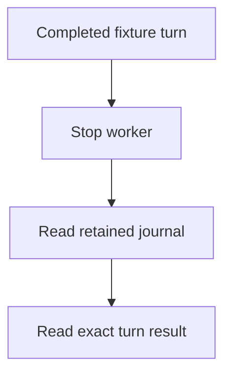

# Inspect evidence after a worker stops

Verify that local history, recorded conversation identity and the exact turn
result remain readable after the fixture worker stops, without attaching or
starting a replacement.

## Follow the SDK boundary



Local history and the exact turn result remain readable after the worker stops, without attaching a replacement. The excerpt below is from the runnable script; its setup and surrounding checks remain in that script.

```python
history = await client.history(reference)
assert history['session_ref'] == reference
assert history['entries']
terminal = await client.turn_result(reference, turn_id)
assert terminal['status'] == 'completed', terminal
```

Continue with [a retained conversation job with real process ownership](../../../docs/examples/connected/conversation-jobs.md) to connect this boundary to Carrier delivery, Undercurrent execution and a checked application result.

## Prerequisites and execution

Use Python 3.11–3.14 and an installed `aixand-conversation-manager` package.
From `conversation-manager/`, run:

```sh
python examples/offline_lifecycle.py
```

The [complete runnable script](../../examples/offline_lifecycle.py) explicitly injects
`conversation_manager.fixture_sdk:factory` into a standalone local worker.
It requires no provider credentials, provider SDK installation, or model requests.
The Claude protocol identifier selects an adapter; the injected driver is the
built-in test fixture, not an authenticated Claude session.

Expect `PASS: stopped fixture worker; retained history and exact turn read without attach`. Assertions verify receipts and observed outcomes rather than
printing success after launch alone. Waits are bounded. On failure inspect the
assertion's retained record and the [recovery guide](../recovery.md).

## Cleanup and limits

After successful startup, the built-in demo terminates its own worker in
`finally`; the example removes its temporary store. If startup is uncertain,
inspect the returned runtime receipt before explicit cleanup. It does not adopt or stop existing workers. These checks establish fixture
behavior only; they do not qualify native providers, platform support or account
entitlement. Read [live qualification](../live-qualification.md) separately.
