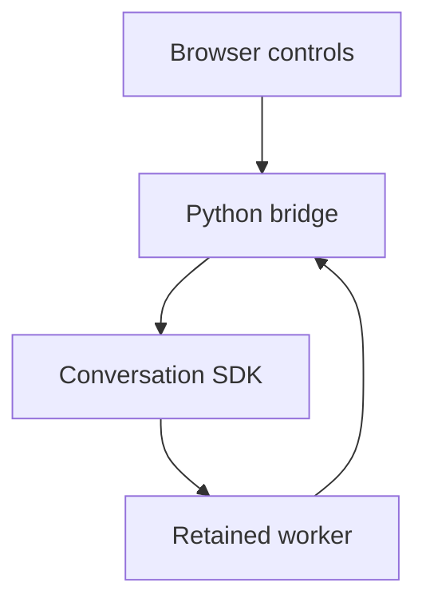
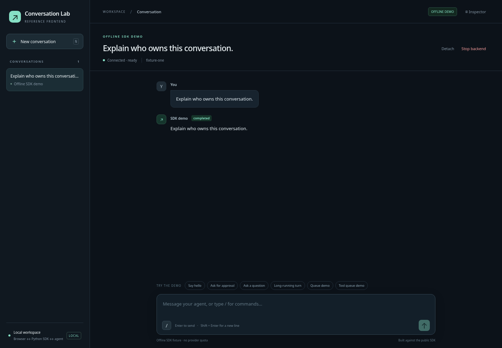
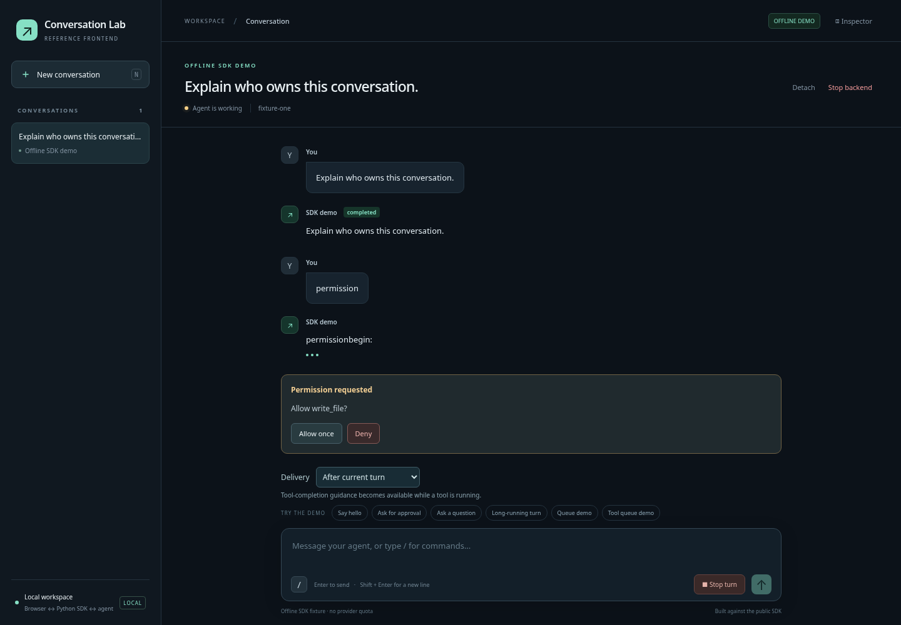

# Explore the reference chat frontend

Use the maintained browser example to inspect settings, approvals, queues and
recovery controls. Its Python bridge uses the public SDK; the browser does not
call provider APIs.

## Follow the SDK boundary



The bridge maps browser actions to public SDK methods and reads the observed worker state back into the UI. The excerpt below is from the runnable script; its setup and surrounding checks remain in that script.

```python
if method == 'GET' and path == '/api/commands':
    return await conversation.list_slash_commands()
if method == 'GET' and path == '/api/settings':
    return await conversation.configuration()
```

Continue with [an application-owned retained conversation](../../../docs/examples/connected/conversation-jobs.md) to connect this boundary to Carrier delivery, Undercurrent execution and a checked application result.

## Start an offline browser session

From `conversation-manager/`, with Python 3.11+ and the package installed:

```sh
python examples/reference_chat/app.py --port 8847 --state /tmp/reference-chat-demo
```

Open http://127.0.0.1:8847 and choose **Offline SDK demo**. This explicitly
injected fixture echoes input without provider credentials or inference. Send
`permission` or `question` to inspect responses, `hold` to try cancellation,
and `queue-demo` to enqueue a follow-up. Try **Tool queue demo** while tools run;
observed completion does not create an exact native execution barrier.

## Inspect the actual fixture UI

These screenshots use the built-in offline SDK fixture and disposable state.
They show an observed completed turn and a pending approval request; no
provider account or model inference was involved.





The application displays the provider's actual choices. Its decision response and
resulting turn must be observed separately. Capture scope and reproduction steps
are recorded in [the capture manifest](../assets/reference-chat/capture.json).

## Retain or clean up

Browser refresh and bridge shutdown retain workers. Restart with the same state
to attach them. **Stop backend** explicitly stops a runtime and all chats sharing
it. For an isolated session, pass `--stop-workers-on-exit` to clean up only startups
requested by that bridge run. Remove the example state directory only after its
workers are stopped and you no longer need recorded history.

This is a single-user development UI without login or TLS. Keep the default
loopback bind. Live discovery requires explicit `--live`, installed optional
dependencies and configured native accounts; live messages can consume quota.
The [owning README](../../examples/reference_chat/README.md) retains network
binding, state, settings interactions and browser-check procedures.

[Bridge source](../../examples/reference_chat/app.py) and
[lifecycle tests](../../examples/reference_chat/tests/test_bridge.py) show the SDK
boundary. The screenshots verify only the fixture interactions described above; they do
not qualify authenticated providers or every reference-UI control.
