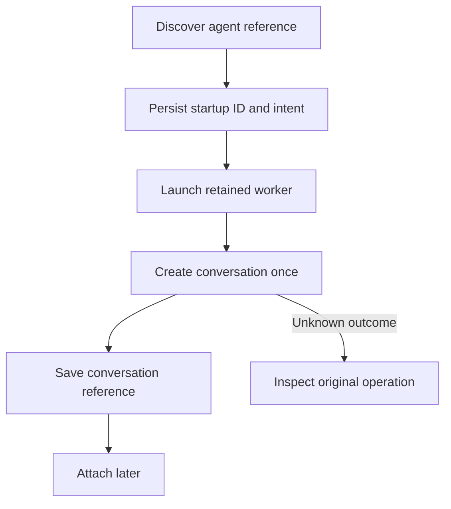

# Attach a frontend and start a conversation

Use `ConversationClient` to discover, start and attach chat sessions. The client
coordinates preparation and launch; the frontend keeps exact references and IDs.



## Start with a selected native environment

This is an async excerpt for a configured, signed-in native environment. Use
absolute paths. Install the appropriate optional dependencies first; see
[getting started](getting-started.md). A live send can consume account allowance.

```python
from conversation_manager import ConversationClient

client = ConversationClient(
    agent_config='/path/to/providers.toml', agent_root='/path/to/agent-state',
)
agents = await client.available_agents()
selected = next(row for row in agents if row['conversation']['supported'])
conversation = await client.start_conversation(
    agent=selected['reference'], cwd='/path/to/project', operation_id='start-chat-1',
)
saved_reference = conversation.reference
startup_receipt = conversation.startup_receipt
```

Persist selection and startup ID before dispatch. `available_agents()` defaults
to Codex and OpenCode. `supported` reports an implemented local path, not sign-in,
account entitlement or readiness. Do not manufacture references from aliases.
Send and wait using the [exact-turn procedure](turns.md).

## Retry or attach

| Task | API and limit |
| --- | --- |
| Recover interrupted startup | Retry exact agent, cwd, settings, ID and launch policy; changed intent conflicts |
| Inspect startup | `await client.operation(id)` exposes child IDs and runtime recovery information |
| Attach saved work | `await client.attach_conversation(saved_reference)`; no new backend or native session |
| List known chats | `await client.conversations(detailed=True)`; local records and reachability, not all native history |
| Detach UI | `await conversation.disconnect()`; retained work continues |
| Clean failed startup | `await client.stop_startup(id, operation_id='cleanup-1')`; stops all work on that runtime |

Unknown creation delivery never authorizes another creation. A successful startup
receipt remains completed after its worker stops; it is not a reachability probe.
Use [explicit recovery](recovery.md) for stopped managed native sessions.

OpenCode chats in one environment/store share a worker. Startup cleanup stops all
of them; native conversation closure is the individual-chat action. Codex server
sharing has a different worker boundary; see [server isolation](codex-server-sharing.md).

[Frontend implementation](../src/conversation_manager/frontend.py),
[client methods](../src/conversation_manager/client.py), and
[startup failure tests](../tests/test_startup_failures.py) own the contract.
The [full frontend reference](frontend-api.md) retains timeout, request, queue,
transcript and recovery details for integrators.
