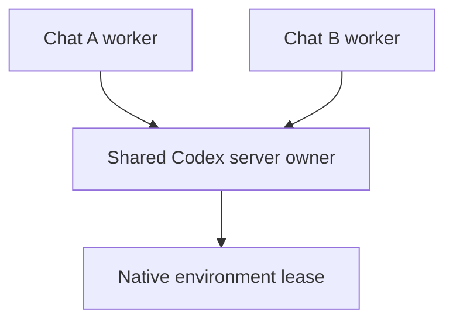

# Choose native server sharing

Choose isolation when starting new work. OpenCode worker sharing and opt-in Codex
server sharing have different lifecycle boundaries.



| Mode | Ownership | Stop effect |
| --- | --- | --- |
| Codex separate, default | Worker owns its native server | Worker termination stops that server |
| Codex shared, opt-in | Worker per chat; independent owner pools compatible server | Worker stop closes its connection; server has separate idle cleanup |
| OpenCode | One worker/server per environment in a store | Worker termination stops all its chats |

## Opt into Codex sharing

This async excerpt assumes a selected native agent reference and configured client:

```python
chat = await client.start_conversation(
    agent=selected_agent, cwd=workspace,
    settings={'access': {'sandbox': 'read-only', 'approvalPolicy': 'on-request'}},
    codex_server_mode='shared', operation_id='stable-startup-id',
)
```

Separate is the default; low-level `launch_codex` uses `server_mode`. Mode is part
of durable launch intent. Same-ID retries cannot change it. Restore retains mode
and native thread identity. Sharing is disabled on Windows pending qualification.

## Check compatibility and recovery

Pool identity includes store, exact environment descriptor/revision and resolved
workspace. Different stores, revisions, environments or workspaces do not share.
Each connection retains approval ownership, settings and RPC identity; worker
queues and receipts remain separate.

The owner considers cleanup after the final client disconnects for 60 seconds.
It also checks activity under the admission lock: turns, requests, queues,
background commands, goals, logins, remote control or uncertain inspection block
shutdown. Attached idle workers keep their connections and therefore keep the
pool alive. Lost transport does not authorize replay of uncertain work.

The [full isolation reference](codex-server-sharing.md) retains Suite policy
integration, lifecycle details and historical Linux benchmark/validation records.
Its five-chat memory measurements are workload-specific; the single-chat baseline
used more memory in shared mode. Do not infer a universal memory or speed gain.
No live benchmark was rerun for this documentation change.

[Shared owner](../src/conversation_manager/shared_codex.py),
[gateway](../src/conversation_manager/native_gateway.py), and
[sharing tests](../tests/test_codex_sharing.py) define the implementation.
