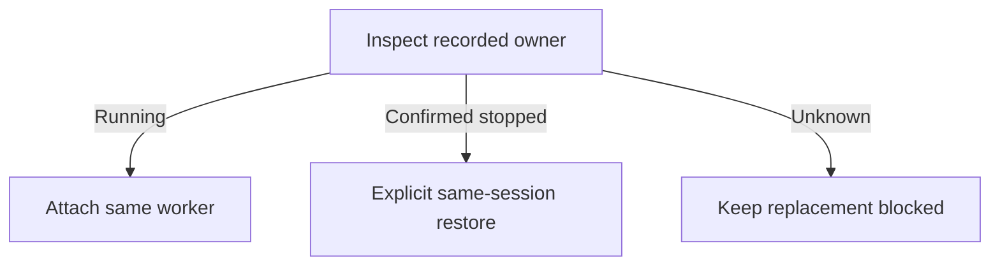

# Recover a retained conversation

Attach to running work first. Restore a stopped native session only through an explicit recovery operation.



## Save identity before detaching

Persist the complete JSON-serializable `conversation.reference` in application
state. It retains native identity and recovery connection/runtime references.
Treat these as exact identities, not provider aliases. Keep the same local store.

```python
saved_reference = conversation.reference
await conversation.disconnect()
conversation = await client.attach_conversation(saved_reference)
```

This is an async excerpt for an existing client. Attachment works while a turn
runs; it does not invoke native load or start a replacement worker.
`reconnect()` reattaches an existing frontend handle. Low-level
`connection.load_conversation()` invokes native load and may require idle state.

## Restore after the owner stops

```python
conversation = await client.resume_conversation(
    saved_reference, operation_id='resume:' + saved_reference['session_id'],
)
saved_reference = conversation.reference
```

For managed Codex/OpenCode, restoration checks the recorded owner. A live owner
keeps its worker. Unknown ownership blocks replacement. A confirmed stopped owner
allows the same native session in the same native home on a replacement runtime.
Save the returned reference. The operation preserves saved history and confirmed
settings; it does not resend old messages, commands or queues. Same-ID retries
use the retained result. It is not cross-environment history transfer.

## Diagnose before cleanup

| Observation | Reader action |
| --- | --- |
| Startup receipt completed, worker unavailable | Inspect runtime; completion records past startup, not current reachability |
| Startup busy | Retry original intent and ID after the concurrent operation finishes |
| Unknown creation or send outcome | Inspect original receipt; do not create a new ID to replay |
| Built-in owner stopped | Attachment reports `runtime_stopped`; explicitly resume when supported |
| Queue dispatch interrupted | Inspect delivery and reconcile only confirmed matching evidence on original worker |
| Failed startup retained a runtime | Inspect child launch receipt; explicitly stop startup if cleanup is intended |

`conversations(detailed=True)` probes recorded workers without launching replacements.
`client.history(reference)` and `client.turn_result(reference, turn_id)` read local
saved evidence without a live connection. A queue snapshot is last-recorded state,
not permission to deliver. See [queues](message-queues.md) and [startup](frontend-api.md).

## Distinguish lifecycle actions

| Action | Effect |
| --- | --- |
| `disconnect()` | Detach frontend; keep runtime/work |
| `cancel(turn_id, operation_id=...)` | Request cancellation of the exact turn; inspect terminal outcome |
| `close(operation_id=...)` | Capability-checked native session closure |
| `stop_startup(id, operation_id=...)` | Stop runtime retained by startup, including failed creation |
| `terminate_runtime(ref, operation_id=...)` | Stop recorded runtime owner and its work |

Stopping an OpenCode shared worker affects all its chats. Closing an individual
chat and terminating a runtime are separate decisions. Shared Codex worker stop
closes its connection, not the independently owned shared server.

[Recovery implementation](../src/conversation_manager/recovery.py),
[frontend startup](../src/conversation_manager/frontend.py),
[recovery tests](../tests/test_recovery_api.py), and
[startup failure tests](../tests/test_startup_failures.py) own the recovery contract.
