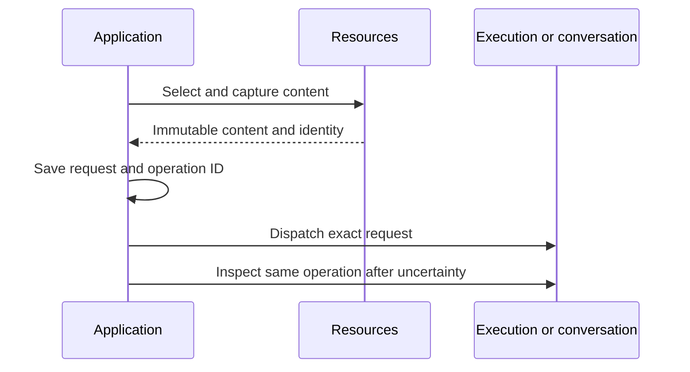

# Compose application resources

Applications combine resource libraries with native agent environments and
retained conversations. Each resource manager owns content and reconciliation;
the application owns selection, composition, and provider delivery.

| Need | Owning API |
| --- | --- |
| Select native environments and launch execution | [Agent Manager SDK](../agent-manager/docs/python-sdk.md) |
| Render accepted prompt content | [Prompt Manager SDK](../prompt-manager/docs/python-sdk.md) |
| Resolve and export complete skill packages | [Skill Manager SDK](../skill-manager/docs/python-sdk.md) |
| Resolve MCP definitions and runtime operations | [MCP connector contract](../mcp-manager/docs/connectors.md) |
| Start or attach retained conversations | [Conversation frontend API](../conversation-manager/docs/frontend-api.md) |

Capture the selected immutable content before dispatch when retries must reproduce
the same request. Keep store identity, content digests, and operation references
with the application's durable task state. Publisher reconciliation must not
silently replace user-customized content during capture.

Credentials belong on the execution machine. Supply references rather than inline
secrets in shared descriptors or workflow history. Required resources must fail
before task dispatch when unavailable; optional omissions need a visible reason.
Supported delivery mechanisms depend on the selected provider's capabilities.

See [integration ownership](integration-architecture.md) and
[resource imports](resource-imports.md) for boundaries and installation behavior.
