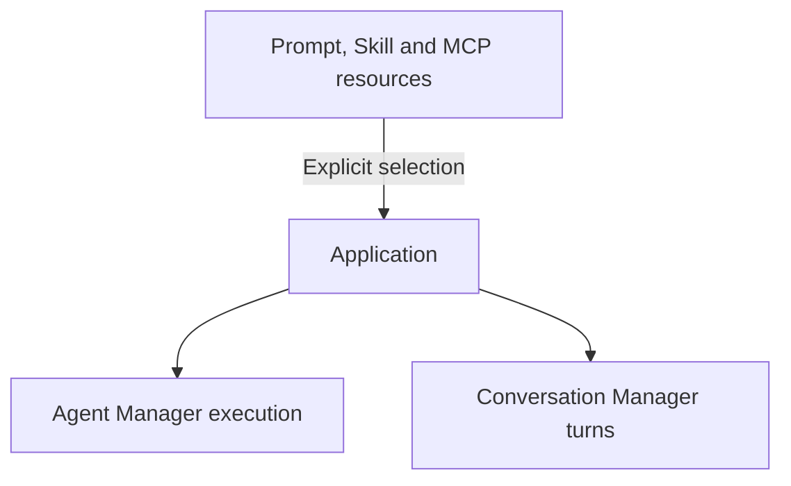

# Understand the five managers

Native execution, retained chat and reusable resources have separate owners.
Choose a manager by the state it owns.

## Choose a manager

| Manager | Command | Owns |
| --- | --- | --- |
| [Agent Manager](../agent-manager/docs/README.md) | `agent` | Native environments, profile aliases, provider authentication context, and terminal launch preparation |
| [Conversation Manager](../conversation-manager/docs/README.md) | `conversation-manager` | Retained chat references, events, approvals, cancellation, and reconnection |
| [MCP Manager](../mcp-manager/docs/README.md) | `mcp-manager` | Explicit server definitions, resource preparation, source/install lifecycle, and injected connector operations |
| [Prompt Manager](../prompt-manager/docs/README.md) | `prompt-manager` | Owned prompt copies, rendering, publisher reconciliation, and immutable snapshots |
| [Skill Manager](../skill-manager/docs/README.md) | `skill-manager` | Native skill packages, accepted copies, project connections, and export |

Manager Suite is the collection. It is distinct from the wider Aixand Suite workspace. The collection packages the five managers. Orchestration MCP is a separate product; this checkout does not require its source.

## Keep execution and conversation separate

Agent Manager's native CLI execution and Conversation Manager's programmatic chat are different surfaces. Opening one does not attach it to the other's process. Conversation Manager uses Agent Manager's public environment contracts when that integration is selected.

Agent Manager has no Prompt, Skill, MCP resource, or Conversation Manager dependency in its base package. Prompt Manager works without third-party runtime dependencies. Skill Manager depends on Prompt Manager's package lifecycle API and filesystem utilities. MCP Manager uses standalone filesystem and GitHub source utilities.

Server Manager and the old resource-sources framework are retired from current builds. Their archived instructions are not current setup steps.

## Stores and ownership

Default manager data lives under `${XDG_DATA_HOME:-~/.local/share}/aixand/manager/`, with `agent`, `conversation`, `mcp`, `prompt`, and `skill` product directories. `AIXAND_MANAGER_ROOT` relocates the shared default root. Explicit CLI/SDK paths and component overrides take precedence.

An owned import captures content in the manager's store. An external draft registration still depends on its original files. A publisher update and a project deployment update are separate decisions; accepted library content is not silently pushed into a running conversation.

## Revisions, releases, and receipts

Revision guards reject writes based on stale observations. Immutable content releases capture the content and dependencies owned by the relevant manager; they are local resource releases, not software package publication.

A request receipt or accepted send does not prove completed work. For conversations, inspect the exact turn completion result. After an uncertain operation, inspect its retained identity before creating new work.

## Compose with Carrier and Undercurrent

[Carrier](https://projects.aixand.org/carrier/) owns durable message exchange. [Undercurrent](https://projects.aixand.org/undercurrent/) owns persistent processes and their observed state. Neither is required for local prompt, skill, or MCP definition management. Agent Manager's async execution SDK requires Undercurrent; its default CLI path uses direct native execution.

Carrier's [optional Agent Manager adapter](https://projects.aixand.org/carrier/docs/integrations/agent-manager/) owns its inbox provisioning and conversation binding. Keep these responsibilities explicit in application code.
