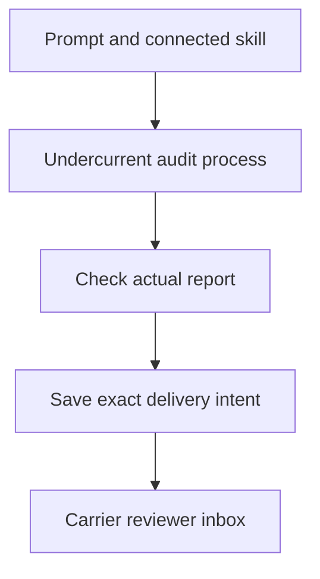

# Audit a CSV and deliver its report

The application checks the process artifact before saving and sending an exact retryable delivery intent.

## Follow the SDK boundary



The application checks the process artifact before saving and sending an exact retryable delivery intent. The excerpt below is from the runnable script; its setup and surrounding checks remain in that script.

```python
report = json.loads(output.read_text())
if report != {"rows": 2, "missing_email_records": [3], "status": "needs-review"}:
    raise RuntimeError("The audit artifact did not match the fixture's acceptance check")
# Keep exact delivery bytes and key before dispatch, so uncertainty is recoverable.
delivery = {"report": report, "evidence": evidence, "session_id": session.id}
body = json.dumps(delivery, sort_keys=True)
key = "audit:" + hashlib.sha256(body.encode()).hexdigest()
intent = {"to": args.to, "content": body, "idempotency_key": key}
(root / "delivery.json").write_text(json.dumps(intent, indent=2) + "\n")
async with Inbox(url=args.url, credentials=args.credentials) as sender:
    message = await sender.send(body, to=args.to, idempotency_key=key)
```

Continue with [the isolated artifact audit with recovery](connected/artifact-audit.md) to connect this boundary to Carrier delivery, Undercurrent execution and a checked application result.

## What the application connects

This example needs no model account. Prompt Manager stores and renders the audit request. Skill Manager accepts a complete local skill package and connects it to a project through an explicit preview/apply step. The application chooses the exported audit script, Undercurrent runs it, and Carrier stores the checked report for a reviewer.

The rendered request is retained as evidence; the deterministic Python auditor implements the stated check. It does not interpret arbitrary prompt text. Skill Manager does not execute skills, and registering a skill alone does not configure a provider.

## Prerequisites

Complete [connected setup](https://projects.aixand.org/undercurrent/docs/guides/connected-examples/) and [start Carrier](https://projects.aixand.org/carrier/examples/persistent-service/). Save both downloads in `connected-demo`. Provision two additional inboxes once against that service's database:

```sh
carrier session sdk/audit-sender --db carrier.db --credentials audit-sender.json
carrier session sdk/audit-reviewer --db carrier.db --credentials audit-reviewer.json
```

The example uses fresh resource stores and a two-row contacts CSV inside the requested work directory. Existing manager homes are untouched.

## Run the audit

```sh
python audit-to-inbox.py --work audit-001 --credentials audit-sender.json
```

`audit-001` must not exist. The script refuses to overwrite an earlier run. Expect a printed Undercurrent session ID and a report with `rows: 2`, `missing_email_records: [3]`, and `status: needs-review`. Record 3 is the second data row because the header is record 1.

The application waits for the session to exit with code 0 and independently checks the report contents. Only then does it send the report. The CSV intentionally contains a missing email, so `needs-review` is a successful detection rather than a process failure.

## Read the report later

The reviewer does not need to be running during the audit. After delivery:

```sh
python audit-inbox.py --credentials audit-reviewer.json
```

Expect one delivery containing the report, session ID, and SHA-256 digests of the rendered request and executed script. The reader acknowledges only after parsing and printing it. Run the reader again; expect `Accepted 0 audit deliveries.` History remains in Carrier after acknowledgment.

## Inspect the retained evidence

| File under `audit-001/` | Purpose |
| --- | --- |
| `request.json` | Exact rendered request |
| `selection.json` | Digests of selected request and executed script |
| `execution.json` | Original Undercurrent session ID |
| `project/skills/csv-audit/` | Connected skill package |
| `project/audit.json` | Checked audit artifact |
| `delivery.json` | Exact recipient, content, and retry key saved before sending |
| `receipt.json` | Numeric Carrier message ID after a successful send |

Use the ID in `execution.json` with `uc inspect` and `uc logs`. Selected bytes remain in this run directory; this example does not provide a general workflow scheduler or automatic crash recovery.

## Recover uncertain delivery

If the send fails or its response is lost, inspect `delivery.json` and retry only that exact intent using the original sender's credentials:

```sh
python audit-inbox.py --credentials audit-sender.json --intent audit-001/delivery.json
```

The same key and bytes return the same stored message ID. This also works after the reviewer acknowledged it. Read the reviewer inbox again to confirm there is no second pending delivery. Do not rerun the audit to recover a delivery: another audit creates a new session and separate evidence.

A wait timeout leaves the original process running. If execution fails before `delivery.json` exists, inspect its session and artifact before choosing to stop it or launch a new run. This script does not resume partial resource preparation.

## Clean up

The audit process exits naturally. Explicitly stop any session left running after a timeout, and stop the shared Carrier service only when finished with the other examples. Keep the work directory and credentials to retain recovery evidence.

For provider-facing composition, see [Prompt Manager](../../prompt-manager/docs/README.md), [Skill Manager](../../skill-manager/docs/README.md), and [the current application resource contract](../application-resources.md).
