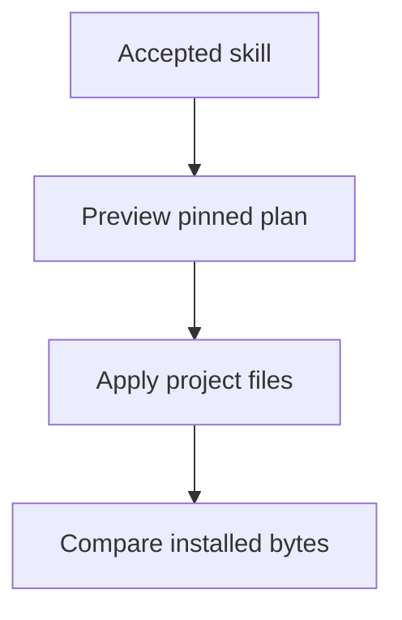

# Connect a skill to a project

Preview produces a plan without changing project files; applying that plan installs the accepted bytes.

## Follow the SDK boundary



Preview produces a plan without changing project files; applying that plan installs the accepted bytes. The excerpt below is from the runnable script; its setup and surrounding checks remain in that script.

```python
plan = project.preview_connect([skill.reference], skills_dir="skills")
assert not (project_root / "skills" / "review").exists()
project.connect(plan)
assert (project_root / "skills" / "review" / "SKILL.md").read_bytes() == content
assert registered.content.read_file("SKILL.md") == content
```

Continue with [a real artifact audit](connected/artifact-audit.md) to connect this boundary to Carrier delivery, Undercurrent execution and a checked application result.

## Prerequisites

Complete [full-suite source setup](../getting-started/installation.md#set-up-the-complete-suite) and activate `.venv`. Run from the `manager-suites` repository root. Save the download as `connect-skill.py` in your working directory. The script uses a temporary store and requires no provider credentials.

## Run the example

```sh
python connect-skill.py
```

The script registers a native `SKILL.md` package, previews a connection, checks that preview changed no files, and applies it into an explicit `skills/` directory. Expect `connected` and `source_unchanged` to be `true`, with `preview_changed_files` set to `false`.

## Runnable source

Read [connect-skill.py](scripts/connect-skill.py) for the complete executable example.

## Verify and clean up

The assertions stop with an error if the expected outcome is not observed. On success, the script prints its checked result. Temporary files are removed automatically when it finishes; default manager stores are untouched.

If imports fail, check your active Python environment. For operation conflicts or missing live tools, follow [troubleshooting](../troubleshooting.md).
