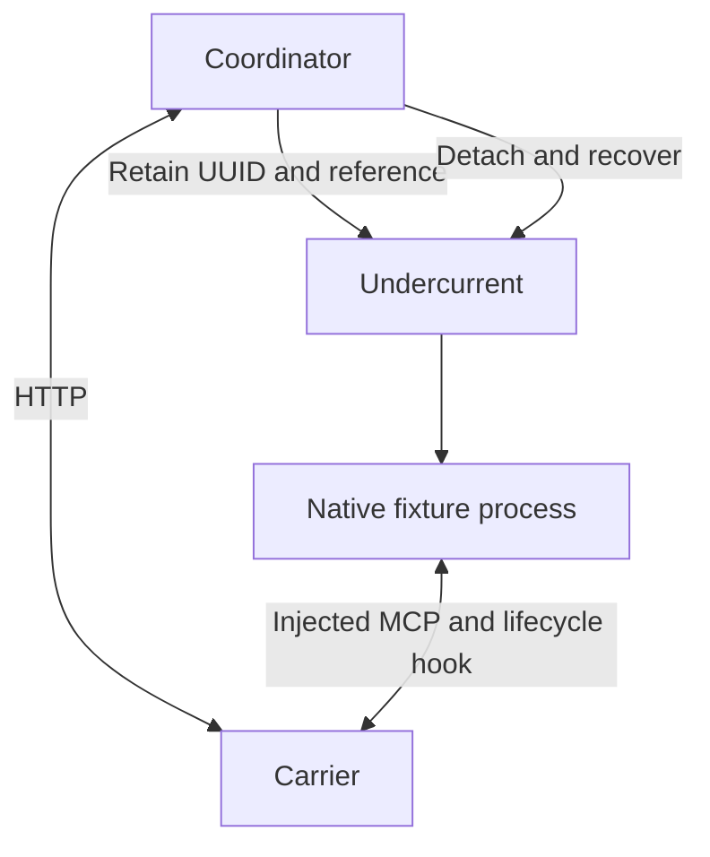

# Recover a native agent and use its mailbox

Retain one Agent Manager execution, detach both launch SDK connections, and recover that same running process. Then send a bounded Carrier request, check its reply, and explicitly stop it. This example combines **Agent Manager**, **CarrierAgents**, **Undercurrent**, Carrier HTTP, and the injected Carrier MCP server.

The default native executable is a deterministic **fake Codex CLI**. It exercises transport and lifecycle behavior; it makes no inference calls and does not qualify a real Codex vendor build. Its uppercase response is ordinary Python code. Carrier and Undercurrent are real services with real SDK transports.



The native process owns its receiving inbox. The coordinator owns a separate inbox; no terminal-forwarding consumer competes with the native MCP tools.

## Run the program

Complete [connected setup](connected-setup.md), including the matching native runtime binaries and Python environment. Run from the **manager-suites checkout** on Linux. Set `RUNTIME_BIN` to the directory containing `uc-daemon` and `uc-python-bridge`; use the setup environment's `python`. Choose a fresh, short work path for every run.

```sh
python docs/examples/connected/agent_mailbox.py --work /tmp/mailbox-demo --runtime-bin "$RUNTIME_BIN"
```

The program creates isolated provider configuration, registry, and `AGENT_MANAGER_HOMES_ROOT` beneath that work directory. It creates a fresh profile, without logging in or copying credentials. Do not replace the fixture executable with a real provider as part of this walkthrough.

## Follow the recovery flow

This is the `recover-mailbox` excerpt from [agent_mailbox.py](agent_mailbox.py); imports and the surrounding `demo` context are omitted. [native_fixture.py](native_fixture.py) contains the deterministic executable and message helpers. `prepare` supplies the isolated paths; `adapter` constructs the real `CarrierAgents` integration.

```python
async with Runtime(**app.runtime.connection_options) as launch_runtime:
    async with Client('codex', **(options | {'runtime': launch_runtime})) as agents:
        integration = adapter(agents, app)
        agent = await integration.spawn(**intent)
        app.sessions.append(await app.runtime.inspect(agent.session_id))
        reference = agent.reference.to_dict()
        save_json(app.root / 'reference.json', reference)
        original = await bound(integration, intent)
        original_pid = (await native_state(app, original['address']))['pid']
# Closing both SDK connections detaches; the native process stays alive.
async with Client('codex', **options) as agents:
    integration = adapter(agents, app)
    agent = await agents.get(json.loads((app.root / 'reference.json').read_text()))
    replay = await integration.spawn(**intent)
    assert replay.reference.to_dict() == reference
    assert (await agent.inspect()).lifecycle == 'running'
    os.kill(original_pid, 0)
    show('recovered', same_reference=True, same_native_pid=True, run_id=agent.run_id)
    async with app.client('coordinator') as inbox:
        message = await request(inbox, app, 'echo', original['address'],
                                dict(task='mailbox-1', action='echo', value='retained process'))
        await trigger(agent, app, 'echo', dict(request_id=message.id,
                      sender=app.addresses['coordinator'], task='mailbox-1'))
        reply = await checked_reply(inbox, message, original['address'], 'mailbox-1')
        assert reply.json()['value'] == 'RETAINED PROCESS'
        save_json(app.root / 'accepted.json', reply.to_dict())
        await reply.ack()
        show('accepted', value=reply.json()['value'], correlated=True, replay_same_message=True)
    await agent.stop()
    stopped = await agent.wait(lifecycle=('stopped', 'exited', 'failed'), timeout=20)
    assert stopped.lifecycle in ('stopped', 'exited', 'failed')
    await integration.reconcile()
    show('stopped', lifecycle=stopped.lifecycle)
```

`worker-launch.json` captures the UUID and exact launch options before submission. `reference.json` targets the original registry, runtime home, run UUID, and Undercurrent session. The replay uses the same launch intent and compares the full reference. Recovery also observes a running lifecycle and checks that the recorded native PID remains alive.

## Check the outcome

Captured from the isolated verification run; your UUID will differ:

```text
recovered: {"run_id": "2dffb89045174e778e35f933ca8db0e3", "same_native_pid": true, "same_reference": true}
accepted: {"correlated": true, "replay_same_message": true, "value": "RETAINED PROCESS"}
stopped: {"lifecycle": "stopped"}
```

Independent application assertions require the expected sender address, numeric `reply_to`, task ID, and exact uppercase value. Launch acceptance alone cannot satisfy them. Inspect `accepted.json`, `echo-send.json`, `echo-input.json`, `echo-input-receipt.json`, and `native-accepted-1.json` under your work directory. The accepted envelope is saved before its acknowledgment, so its captured `acknowledged_at` can be null. The program separately observes acknowledgment of its request. Identical Carrier sends return the same numeric message ID; terminal replay uses the same delivery UUID and must report a duplicate.

## Recover and clean up

If a send response is lost, retain the saved destination, body, and key; replay those unchanged. If launch submission is uncertain, retain `worker-launch.json` and recover through its UUID rather than choosing a new launch. Missing original stores require investigation, not replacement identities. These are inspectable recovery records; this single-run tutorial does not provide a resume command after coordinator process death.

All waits have deadlines. The fixture durably saves reply intent before sending and acknowledges only after local acceptance. That journal does not promise exactly-once external side effects. The program explicitly stops the native execution, reconciles its binding, then the shared context stops Carrier and its daemon. Require `cleanup.json` to contain `owned_sessions_stopped: true`, `daemon_exited: true`, and an empty `failures` list. Evidence remains private in the work directory.
