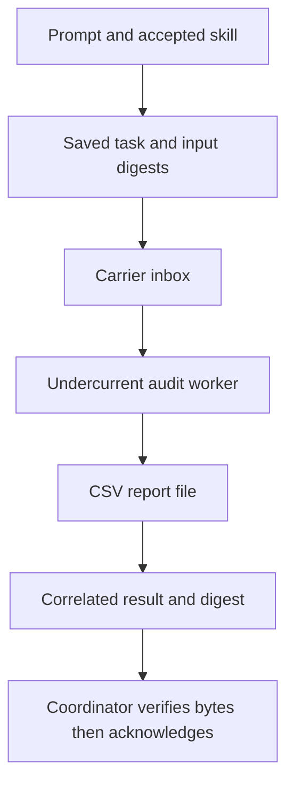

# Deliver a verified audit artifact

Send an audit while its worker is offline, then check the actual report before
accepting the reply. Prompt Manager captures the request, Skill Manager delivers
the auditor, Undercurrent runs it, and Carrier retains the messages.



## Run the application

Complete [connected setup](connected-setup.md). From the Manager Suite checkout:

```sh
python docs/examples/connected/artifact_audit.py \
  --work /tmp/contacts-audit-demo --runtime-bin "$RUNTIME_BIN"
```

Four fixture contacts include two missing email addresses. The auditor is a trusted
deterministic skill script; it implements the stated rule instead of asking a model
to interpret arbitrary text. No account or inference is involved.

## See the SDK handoff

The application registers and renders an owned prompt, registers the complete
`contact-audit` package, then explicitly previews and applies its project connection.
The following worker excerpt runs the selected script through the public runtime
SDK and replies only after checking the output:

```python
session = await runtime.start(
    [sys.executable, str(script), str(source), str(output)],
    name='contact-audit', cwd=str(root / 'project'), detection=False,
)
save_json(root / 'execution.json', {'session_id': session.id})
final = await runtime.wait(session, lifecycle={'exited', 'failed', 'stopped'}, timeout=15)
assert final.lifecycle == 'exited' and final.raw['lifecycle']['code'] == 0
report = json.loads(output.read_text())
assert report == {'rows': 4, 'missing_email_records': [3, 5], 'status': 'needs-review'}
digest = hashlib.sha256(output.read_bytes()).hexdigest()
result = {'task_id': task['task_id'], 'report': report, 'artifact_sha256': digest,
          'session_id': session.id}
save_json(root / 'result-before-reply.json', result)
await request.reply_json(result, idempotency_key='audit-result:' + str(request.id))
await request.ack()
```

The coordinator checks the expected worker identity and task, compares the returned
digest with `project/audit.json`, saves `acceptance.json`, and acknowledges the reply.
It starts the Carrier service and worker as separate real Undercurrent processes.
[Application](artifact_audit.py) and [worker](artifact_worker.py) contain the complete
flow, including the Prompt and Skill SDK calls.

## Check the observed result

Captured from the executed workflow:

```text
Queued audit: {"message_id": 1, "task_id": "contacts-001", "worker_running": false}
Checked artifact: {"digest_matches": true, "missing_email_records": [3, 5], "rows": 4, "status": "needs-review"}
Replay: {"original_message": true, "pending_replies": 0, "reran_auditor": false}
Evidence: {"files": ["captured-prompt.json", "delivery.json", "execution.json", "project/audit.json", "acceptance.json"]}
```

`needs-review` is the correct application result: records 3 and 5 lack email.
The header counts as record 1. The verifier separately asserts four rows, the exact
missing-record list, successful process exit and the artifact digest.

| Evidence under the work directory | What it proves |
| --- | --- |
| `captured-prompt.json` | Original rendered task content |
| `delivery.json` | Exact destination, serialized task and retry key before sending |
| `execution.json` | Actual auditor runtime session |
| `project/audit.json` | The checked artifact |
| `acceptance.json` | The accepted correlated result |

## Recover and finish

The program repeats the original send after acknowledgment and verifies the same
numeric request ID, no pending reply and no second auditor execution. That is send
recovery, not a new audit. A malformed result or digest mismatch fails before the
coordinator acknowledges it.

For an unexpected timeout, inspect the saved process identity and artifact before
creating another task. The harness stops its isolated processes on exit; inspect
`cleanup.json` and retain the work directory until finished. Production recovery
must reopen the original runtime and identities rather than inventing replacement
work. This program does not resume arbitrary partial preparation across invocations.
