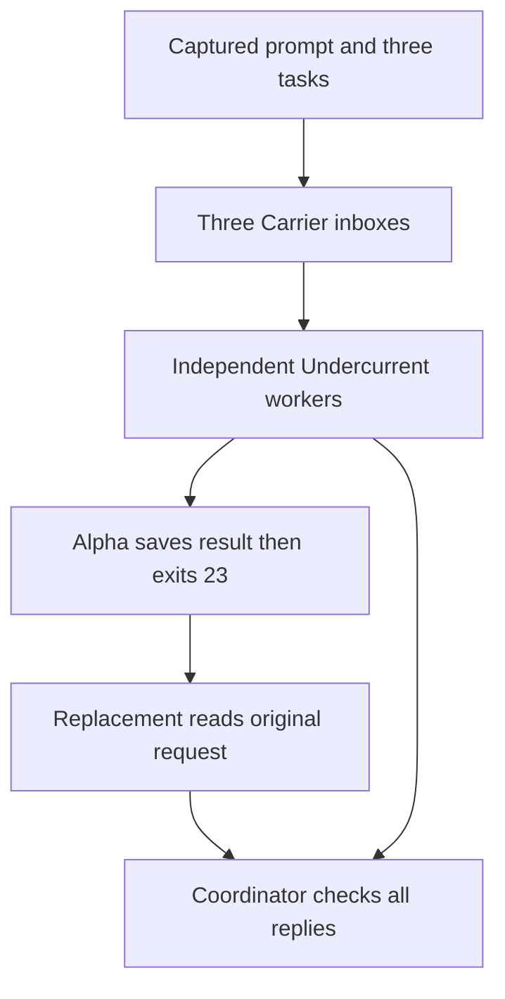

# Recover a failed worker in a three-way batch

Distribute three requests to three separate inbox owners, stop one after it saves
its result, and recover that same job. Prompt Manager owns the captured task;
Carrier retains delivery, and Undercurrent owns four observed worker executions.



## Run the batch

Complete [connected setup](connected-setup.md), then run from the Manager Suite root:

```sh
python docs/examples/connected/batch_pipeline.py \
  --work /tmp/batch-recovery-demo --runtime-bin "$RUNTIME_BIN"
```

The three inputs contain two, one and three nonempty lines. A deterministic worker
implements that fixed rule; the stored prompt identifies its application protocol.
No model or provider login is needed.

## Dispatch through the SDKs

Each role has one inbox and one receiving owner. This is explicit partitioning,
not competing workers racing for a leased message:

```python
for role, content in jobs:
    app.identity(role)
    task = {'job': role, 'text': content, 'messages': messages}
    intent = {'to': app.addresses[role], 'content': json.dumps(task, sort_keys=True), 'idempotency_key': 'count:' + role}
    save_json(app.root / ('intent-' + role + '.json'), intent)
    requests[role] = await coordinator.send(**intent)
    intents[role] = intent
for role, _ in jobs:
    command = [sys.executable, '-B', Path(__file__).with_name('batch_worker.py'),
               '--work', app.root, '--url', app.url, '--credentials', app.credentials[role], '--role', role]
    if role == 'alpha':
        command.append('--crash-after-save')
    workers[role] = await app.start(command, name='count-' + role)
```

Alpha's first process saves a result and deliberately exits with code 23 before
publishing a reply or acknowledging the request. The replacement uses the original
credentials, message ID and retained result:

```python
if journal.exists():
    retained = json.loads(journal.read_text())
    assert retained['request_id'] == request.id and retained['task'] == task
    result = retained['result']
else:
    result = {'job': task['job'], 'lines': sum(bool(line.strip()) for line in task['text'].splitlines())}
    save_json(journal, {'request_id': request.id, 'task': task, 'result': result})
if args.crash_after_save:
    raise SystemExit(23)  # A deliberate failure after durable acceptance.
await request.reply_json(result, idempotency_key='batch-result:' + str(request.id))
await request.ack()
```

Saving before acknowledgment makes that demonstrated restart inspectable. For a
remote API side effect, you would also need that destination's idempotency contract
or a suitable transaction; Carrier alone does not provide exactly-once effects.

## Inspect the result

Captured from the completed run:

```text
Interrupted worker: {"exit_code": 23, "pending_requests": 1, "retained_result": true}
Accepted result: {"job": "alpha", "lines": 2}
Accepted result: {"job": "beta", "lines": 1}
Accepted result: {"job": "gamma", "lines": 3}
Batch verified: {"duplicate_requests": 0, "jobs": 3, "original_result_reused": true, "total_lines": 6}
```

The application checks each reply's sender, original request correlation, job ID
and expected count. It saves each accepted result before acknowledgment, checks
successful exits for the three completing workers, retries each original send and
confirms the coordinator has no pending results.

`result-alpha.json` survives the first process; `accepted-alpha.json` records the
coordinator's decision. `batch-result.json` contains all three verified results.
The returned total is checked against 6; it is not inferred from process readiness.

## Diagnose or finish

A stopped worker does not cancel its stored request. Reuse its inbox identity and
original task when recovering. Do not start two active receivers for the same role.
A wrong sender, wrong count or changed task in the retained journal fails the check.
The crash in this walkthrough is deliberately after durable result storage, not a
claim of recovery from every possible filesystem or power-loss boundary.

The context stops remaining sessions and its isolated daemon. Confirm
`cleanup.json`, then retain or remove only the fresh example work directory.
[Coordinator](batch_pipeline.py) and [worker](batch_worker.py) show the full program.
