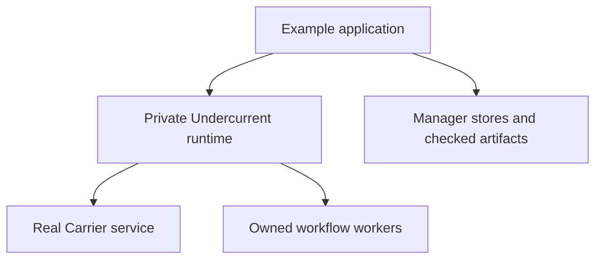

# Prepare the connected SDK workflows

Run complete local applications that combine Manager Suite, durable Carrier
inboxes and real Undercurrent processes. The examples keep their own stores and
check the returned work before acknowledging it.

## Prepare the application environment

Run from the current Manager Suite source checkout. Its root development
environment includes all five managers, Carrier, the Undercurrent Python SDK and
the MCP SDK:

```sh
./dev.sh develop
source .venv/bin/activate
python -c 'import agent_manager, conversation_manager, prompt_manager, skill_manager, mcp_manager, carrier, undercurrent'
```

Use [package development](../../DEVELOPMENT.md) for Python, uv, PowerShell and
source-versus-published dependency details. These walkthroughs target matching
current sources; native commands' private environments do not supply Python
imports to your application. Carrier's legacy optional Agent extra is not needed
by root development; current Agent Manager is already installed here.

Supply a matching Undercurrent daemon and Python bridge pair. Set this directory
to your installed runtime or qualified source build:

```sh
export RUNTIME_BIN=/absolute/path/to/undercurrent/bin
"$RUNTIME_BIN/uc-daemon" --version
test -x "$RUNTIME_BIN/uc-python-bridge"
```

[Undercurrent installation](https://projects.aixand.org/undercurrent/docs/installation/)
owns native setup. The examples do not compile or install executables. The recorded
runs used Linux; they do not qualify Windows/macOS native behavior.

## Run one workflow

Choose a fresh, short work directory. Run commands from the Manager Suite root:

```sh
python docs/examples/connected/artifact_audit.py \
  --work /tmp/contacts-audit-demo --runtime-bin "$RUNTIME_BIN"
```

The program refuses an existing work directory. This prevents accidentally
replacing prior evidence. If a run failed, inspect its existing evidence, then
choose a new directory for a new run.

## Understand the infrastructure



[connected_runtime.py](connected_runtime.py) starts that infrastructure, provisions
private inbox credentials and checks HTTP readiness and authenticated identity.
It does not mock SDKs, use normal manager stores, start your default daemon, or
sign into a provider. Each guide shows the application SDK flow on top of it.

The deterministic examples use real transport and processes. Some use an explicit
local MCP server or native/provider fixture. Those fixtures implement a bounded
application protocol; they do not interpret arbitrary prompts or establish live
model behavior. The [live worker/reviewer](live-review.md) is the separate
account-backed path and can consume provider quota.

## Inspect and finish

The nine repeatable workflows use the shared harness and retain `run.json`,
process identities, manager state and task-specific acceptance records. The live
workflow retains its launch/input references, protocol evidence and checked report
instead. Both paths write `cleanup.json`, which must report:

```json
{"daemon_exited": true, "failures": [], "owned_sessions_stopped": true}
```

Each path stops sessions in its isolated runtime and then its daemon. Closing a
SDK client alone is not termination. Do not remove state while its processes
remain uncertain. After inspection, you may remove only the disposable work
directory you supplied.

These programs demonstrate specific retry/restart boundaries inside a run. They
are not a general scheduler that resumes arbitrary partially completed runs. Keep
original task bytes, credential identity and operation references when adapting
the patterns to a persistent application.

## Verify the repeatable catalog

```sh
python docs/examples/connected/check_snippets.py
python docs/examples/connected/verify.py --runtime-bin "$RUNTIME_BIN"
```

This runs the nine local workflows in fresh directories, checks their application
assertions and verifies cleanup. Logs and a JSON summary remain at the printed
path. It never runs the authenticated model workflow. Use `--only mcp_job` to
check one recovery boundary.
