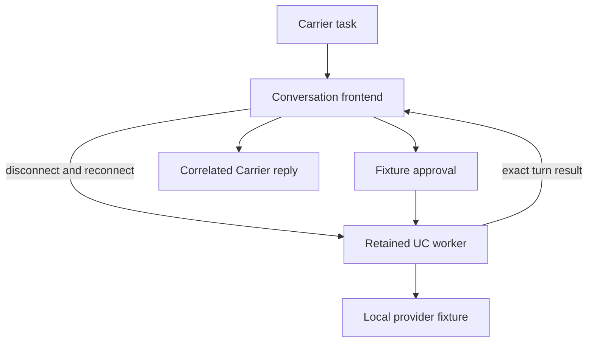

# Deliver a task to a retained conversation worker

Send a Carrier task into a retained Conversation Manager worker, disconnect its frontend during an approval request, reconnect to the same Undercurrent process, and return the verified turn result. The deliberately injected `conversation_manager.fixture_sdk:factory` provides deterministic local behavior. The backend labels identify the adapter protocol; no Claude account or model call is used. Its approval produces a fixture event and the text `approved`; it does not write a file.

The diagram separates the retained worker from the disposable frontend connection.



Complete [connected setup](connected-setup.md) first. From the manager-suites checkout, use its activated Python environment and matching executables:

```sh
python docs/examples/connected/conversation_jobs.py --work /tmp/conversation-demo --runtime-bin "$RUNTIME_BIN"
```

The public `WorkerLauncher` owns worker bootstrap and connection records. The example's small `Owner` implements the public `ProcessOwner` contract with the shared runtime's real Undercurrent `start`, `inspect`, and `stop`. It retains each returned session and rejects unknown identities before inspecting or stopping. There is one retained provider worker and one Carrier service. The coordinator and Carrier job consumer share the frontend process, using different credentials and one receiving owner per inbox.

This `retained` excerpt from [the runnable program](conversation_jobs.py) starts after durable task acceptance:

```python
                sent = await chat.send(task['prompt'], operation_id=task['operation'])
                assert sent['status'] in {'accepted', 'completed'}, sent
                turn = sent['result']['turn_id']
                await chat.disconnect()
                assert (await owner.inspect(ref['runtime_ref']))['state'] == 'running'
                await chat.reconnect()
                assert chat.connection.ref == ref
                pending = await until(chat.pending_requests, bool)
                assert len(pending) == 1
                approval = {'outcome': 'selected', 'option_id': 'allow_once'}
                save_json(app.root / 'approval-intent.json', dict(request_id=pending[0]['request_id'],
                    response=approval, operation_id='fixture-approve-once'))
                await chat.respond(pending[0]['request_id'], approval, operation_id='fixture-approve-once')
                async def result():
                    return await chat.turn_result(turn)
                completed = await until(result, lambda row: row.get('status') == 'completed')
                assert completed['final_text'] == 'approved', completed
                assert completed['turn_id'] == turn and completed['operation_id'] == task['operation']
                assert completed['truncated'] is False
                save_json(app.root / 'turn-result.json', completed)
                response = {'task': task['task'], 'operation': task['operation'], 'turn_id': turn,
                    'final_text': completed['final_text'], 'runtime_ref': ref['runtime_ref']}
                save_json(app.root / 'response-intent.json', dict(body=response, key='review-result', reply_to=job.id))
                await job.reply_json(response, idempotency_key='review-result')
                answer = await coordinator.wait_for_reply(request)
                assert answer.sender == app.addresses['worker'] and answer.reply_to == request.id
                assert answer.json() == response
                save_json(app.root / 'verified.json', answer.json())
                await answer.ack()
```

Captured terminal output:

```text
Conversation verified: {"final_text": "approved", "owned_workers": 1, "provider": "local-sdk-fixture", "reconnected_same_runtime": true}
```

The observed `turn-result.json` contains `status: completed`, `final_text: approved`, `operation_id: inventory-review-turn`, `source: sdk-observed`, and `truncated: false`. Its exact turn ID must match the send result. The Carrier reply contains that same turn ID, task, operation, final text, and runtime reference. The coordinator checks the authenticated worker sender and original request correlation before saving `verified.json` and acknowledging the response.

Recovery here means frontend disconnect/reconnect while the retained worker stays alive. The program asserts Undercurrent reports the recorded runtime running during the disconnect. Reconnect retains the connection identity. The pending request must belong to the same conversation. Before responding, `approval-intent.json` records its request ID, selected option, and stable approval operation. This intentional local approval is authorized by the example; it is not a blanket approval policy for real tools.

`task-intent.json` precedes Carrier sending; `accepted-task.json` precedes request acknowledgment. `response-intent.json` precedes reply publication. These records make intent inspectable. This walkthrough does not implement a full coordinator restart loop or recover a killed provider process. Production recovery must load the recorded connection/conversation and use the same operation identities, then reconcile turn state before retrying. Do not treat an uncertain send receipt as completion or launch a replacement worker blindly.

On exit the launcher terminates through its recorded owner. `owner-stopped.json` confirms the observed terminal lifecycle. The shared context independently stops all tracked sessions and the daemon; `cleanup.json` must show no failures. Evidence remains under the chosen work path.

Sources: [public launcher and owner contract](../../../conversation-manager/src/conversation_manager/managed_launcher.py), [conversation API](../../../conversation-manager/src/conversation_manager/conversation.py), and [explicit provider fixture](../../../conversation-manager/src/conversation_manager/fixture_sdk.py).
