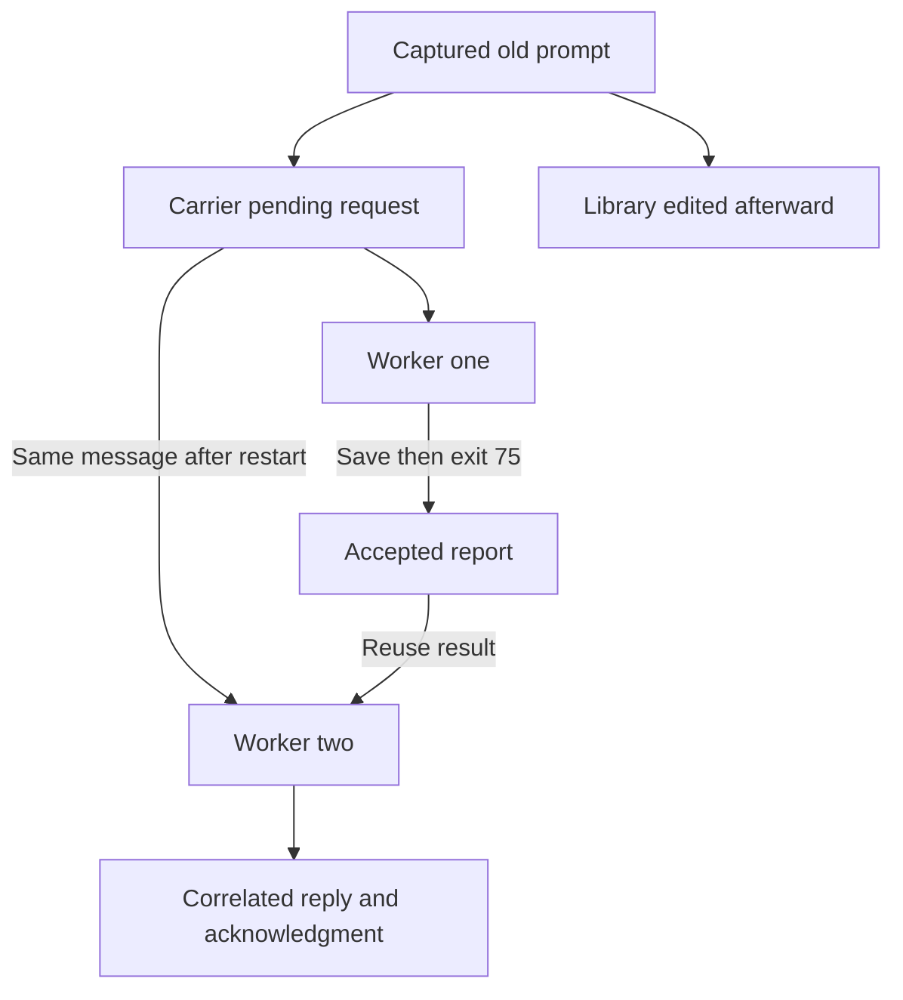

# Recover a report with its original prompt

Keep queued work stable while the accepted prompt changes. This application
captures a Prompt Manager revision and rendered messages, queues them through
Carrier, then edits the accepted prompt. An Undercurrent worker saves the original
report and deliberately exits **75** before sending its reply or acknowledging
the request. A second real worker process reuses the saved result and completes
the original delivery.

The report is an actual local calculation of paid invoice totals. No model or
provider runs. The goal is to make the boundary between prompt authoring,
application acceptance, and message acknowledgment observable.



## Run the recovery

Complete [connected setup](connected-setup.md). Run from the Manager Suite checkout
on Linux with its activated SDK environment, matching runtime binaries and a
fresh, short work directory. This example uses deterministic application code;
it makes no model calls.

```sh
python docs/examples/connected/frozen_prompt.py --work /tmp/connected-frozen --runtime-bin "$RUNTIME_BIN"
```

The [complete program](frozen_prompt.py) imports `launch` from
[prompt_worker.py](prompt_worker.py) and starts [resource_worker.py](resource_worker.py)
twice. Worker names differ because Undercurrent reserves names even after exit.
The coordinator waits for the first process to terminate before starting the next;
there is never a competing owner of the worker inbox.

## Freeze intent before changing content

This exact `frozen-delivery` excerpt requires the surrounding async program:

```python
old = package.render('report', revision=created['revision'], format='messages')['output']
payload = {'task': 'frozen-report', 'kind': 'report', 'revision': created['revision'],
           'prompt': old, 'invoices': [{'cents': 12500, 'paid': True},
                                     {'cents': 2750, 'paid': True}]}
intent = {'sender': app.addresses['coordinator'], 'to': app.addresses['worker'],
          'key': 'frozen-report-request', 'payload': payload}
path = app.root / 'delivery-intent.json'
save_json(path, intent)
async with app.client('coordinator') as inbox:
    request = await inbox.send_json(payload, to=intent['to'], idempotency_key=intent['key'])
    package.save({'body.md': 'Report all invoices, including unpaid invoices.'},
                 expected_revision=created['revision'])
    new = package.render('report', format='messages')['output']
    assert old != new
    await launch(app, path, interrupt=True)
    accepted_path = app.root / 'frozen-report-result.json'
    first_bytes = accepted_path.read_bytes()
    first_stat = accepted_path.stat()
    assert (await inbox.delivery_status(intent['key']))['status'] == 'stored'
    assert not (await inbox.receive_pending()).messages
    replay = await inbox.send_json(**{'content': payload, 'to': intent['to'],
                                     'idempotency_key': intent['key']})
    assert replay.id == request.id
    await launch(app, path)
    reply = await inbox.wait_for_reply(request, timeout=10, poll_interval=.05)
    assert reply.sender == intent['to'] and reply.reply_to == request.id
    result = reply.json()
    assert result['task'] == payload['task'] and result['prompt'] == old
    assert result['total_cents'] == 15250 and result['effect_count'] == 1
    assert accepted_path.read_bytes() == first_bytes
    assert accepted_path.stat().st_mtime_ns == first_stat.st_mtime_ns
    observations = [json.loads(p.read_text()) for p in app.root.glob('frozen-report-worker-*.json')]
    assert len(observations) == 2 and len({r['pid'] for r in observations}) == 2
    assert sorted(r['receipt_reused'] for r in observations) == [False, True]
    save_json(app.root / 'accepted-reply.json', reply.to_dict())
    await reply.ack()
    assert (await inbox.delivery_status(intent['key']))['status'] == 'acknowledged'
```

A package reference follows current content; a retained revision selects history.
The saved delivery intent contains the exact payload, destination, authenticated
sender and sender-scoped retry key. The second send uses that same identity and
must return the original message ID. New content under the same key would be a
conflict, not a request update. See [Prompt Manager history](../../../prompt-manager/docs/python-sdk.md)
and [Carrier retry behavior](https://github.com/Aixand/carrier/blob/main/carrier/sdk.py).

## Inspect the verified recovery

Captured terminal output from a run that exited zero:

```text
Frozen report verified: {"new": "Report all invoices, including unpaid invoices.", "old": "Report paid invoice totals in cents.", "result_unchanged": true, "same_message": true, "total_cents": 15250}
```

Inspect `/tmp/connected-frozen/frozen-verification.json`, `delivery-intent.json`,
`frozen-report-result.json` and `accepted-reply.json`. The two
`frozen-report-worker-*.json` observations record distinct process IDs and receipt
reuse values `false` then `true`. `interrupted-session.json` records exit code 75;
`worker-session.json` records code 0. The coordinator checks that the receipt bytes
and modification time remain unchanged, and that the request stays `stored` with
no pending reply between processes. It then validates the reply's task, sender,
correlation, original prompt and total before acknowledging.

## Understand the recovery boundary

The controlled fault occurs after the report receipt is saved and before reply
or acknowledgment. A replay checks the saved full intent and message identity,
then reuses that receipt. This avoids a second report write in this tested path.
It does not promise exactly-once external effects, filesystem power-loss recovery,
daemon restart recovery, or transactions across report storage and Carrier. A real
payment or email needs its own application idempotency boundary.

Invalid messages stay unacknowledged. Preserve uncertain intents and receipts;
do not replace the retry key merely because a response is missing. A saved reply
intent also precedes reply publication. Context exit stops all owned processes
and the private daemon. Inspect `cleanup.json`; remove only this disposable work
directory after reviewing its private evidence.
