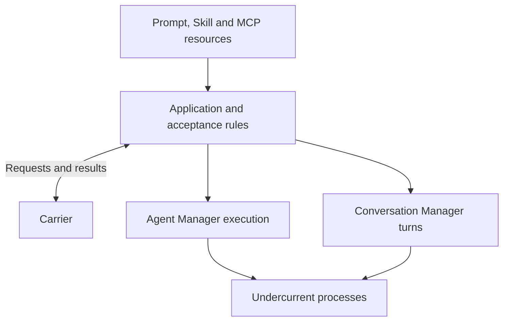

# Build an application across the managers

Follow a request from reusable content to a running worker, a durable inbox and a
checked result. Each walkthrough includes SDK code, real execution output, failure
behavior and retained evidence.

## Choose an outcome

Start with [connected setup](connected-setup.md). The first nine workflows need
no model account. The final workflow runs an authenticated Codex worker and reviewer.

| Workflow | Manager SDKs | What you will observe |
| --- | --- | --- |
| [Report worker](prompt-worker.md) | Prompt | Rendered task → queued request → correlated report |
| [Captured prompt](frozen-prompt.md) | Prompt | A queued task retains its original content after the library changes |
| [Artifact audit](artifact-audit.md) | Prompt + Skill | Exported skill runs as a real process; report bytes and digest are checked |
| [Guarded skill rollout](skill-rollout.md) | Skill | Delivery conflict, reviewed update and verified project files |
| [Batch recovery](batch-pipeline.md) | Prompt | Three workers; one exits after saving its result and recovers the original job |
| [MCP inventory job](mcp-job.md) | MCP | Actual tool invocation; worker restart; one SQLite allocation |
| [Retained conversation job](conversation-jobs.md) | Conversation | Undercurrent-owned chat worker, reconnect and an explicit fixture approval |
| [Native task mailbox](agent-mailbox.md) | Agent | Keyed launch, SDK detach/recovery and a checked inbox result |
| [Parallel acceptance gate](parallel-gate.md) | Agent | Two independent native fixtures, a real artifact and verified sign-off |
| [Live worker and reviewer](live-review.md) | Agent | Authenticated native models exchange policy and independently review the report |

Every workflow uses Carrier and Undercurrent. Repeatable native/provider fixtures
are labeled in their guides; they exercise transport and lifecycle, not inference.

## Assign ownership before writing the application

Capturing content does not dispatch work. Storing a message does not finish a task.
A terminal input receipt does not prove a model answered it. The examples retain
those intermediate identities and check the result required by their application.

Use the smaller [prompt](../render-prompt.md), [skill](../connect-skill.md),
[MCP](../resolve-mcp.md) and [conversation](../retained-conversation.md) examples
when learning an individual API. Return here to see them operate together.
