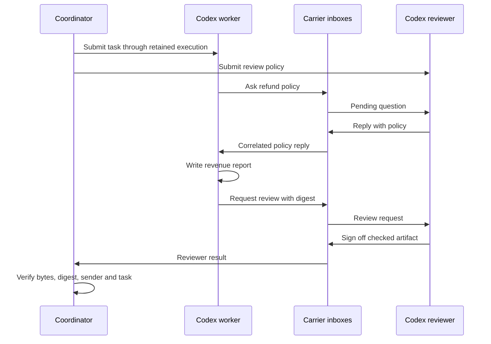

# Run a live worker and reviewer

Two authenticated native Codex executions share a revenue task through Carrier.
The worker asks the reviewer about refund policy, writes a report, and requests
review. The coordinator accepts the result only after independently checking the
artifact, digest, task identity and reviewer address.

Unlike the [repeatable acceptance gate](parallel-gate.md), this walkthrough runs
actual models. Both executions use your selected existing profile; they are
separate processes, not separate provider accounts.



## Prepare and run

Complete [connected setup](connected-setup.md). Keep current Carrier and Manager
Suite source checkouts beside one another; the runner uses their maintained task
and launch utilities. Authenticate your chosen Codex profile beforehand. This
program does not sign in or change provider permissions and can consume quota.
This path also requires the `uc` CLI alongside `uc-daemon` and `uc-python-bridge`
in `RUNTIME_BIN`; it uses the CLI for private daemon startup and shutdown.

From Manager Suite:

```sh
python docs/examples/connected/live_review.py \
  --carrier-source ../carrier --runtime-bin "$RUNTIME_BIN" \
  --profile work --timeout 180
```

Replace `work` with your existing profile. The runner prints a fresh evidence
path, starts a private runtime and Carrier, and creates disposable projects. It
handles the generated projects' explicit trust prompts. Provider access remains
subject to the profile's permissions and availability.

## Launch through the real integration

The runner delegates execution lifecycle to
[managed_agent.py](../scripts/managed_agent.py). This excerpt from that utility
shows the actual SDK integration; `intent` was saved before submission:

```python
async with runtime:
    async with Client(
        intent["provider"],
        runtime=runtime,
        config=intent["config"],
        root=intent["root"],
    ) as agents:
        adapter = None
        if intent["carrier"]:
            from carrier.integrations.agent_manager import CarrierAgents

            adapter = CarrierAgents(agents, **intent["carrier"])
        if args.action in ("launch", "retry-launch"):
            launcher = adapter or agents
            try:
                agent = await launcher.spawn(
                    profile=intent["profile"],
                    cwd=intent["cwd"],
                    idempotency_key=intent["operation_id"],
                    detection=intent["detection"],
                )
            except LaunchError as error:
                write_json(state / "launch-error.json", {"run_id": error.run_id})
                raise
            write_json(state / "reference.json", agent.reference.to_dict())
```

`CarrierAgents` injects the native Carrier MCP tools and lifecycle binding.
Each execution retains its reference and input delivery identity. Sending input
only confirms delivery; the coordinator waits for the review protocol and checks
its result. The runner checks the actual acknowledged policy question and numerically
correlated decision, then the worker's original completion and correlated accepted
review. `protocol-evidence.json` retains those message identities. Cleanup stops
recorded executions, inventories the private runtime's remaining sessions, observes
terminal lifecycles, and checks daemon shutdown. A cleanup failure fails the run;
inspect `cleanup.json` and `stopped-sessions.json`.

## Observed result

A Linux run against current sources and an authenticated profile produced the
following workflow output. Its retained Carrier database also passes the current
protocol-evidence check; the runner now verifies cleanup before printing PASS:

```text
Ready/bound: worker
Ready/bound: reviewer
Task delivered: reviewer
Task delivered: worker
Verified artifact: Net revenue: 1175.00
Acceptance: {"digest_checked": true, "expected_sender": true, "task_id": "revenue-001"}
```

The accepted report contains `Net revenue: 1175.00` followed by a newline. Its
SHA-256 is `f1aa3994939d131f38eca835574cb024d3283e3adf6ec99e2c6886a29b88cca1`.
The reviewer checks the report; the coordinator repeats the artifact and digest
check rather than trusting a model's completion claim.

## Inspect a failure

Keep the printed evidence directory. Inspect saved task inputs, native execution
references, inbox messages and the generated report. A timeout, unbound mailbox,
missing policy exchange or incorrect digest fails the run. Model wording and
latency vary; the application acceptance rule stays fixed. Re-run in a fresh
workspace after diagnosing the failure; the runner is not a general crash-resume
scheduler.
