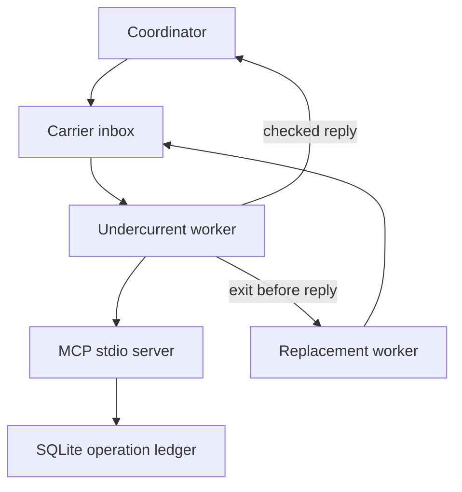

# Recover a tool job after its worker exits

Allocate three inventory units, interrupt the worker after the tool completes, and recover the correlated result without another allocation. This development-checkout example connects MCP Manager, Carrier, Undercurrent, and the actual MCP Python SDK. The inventory server is a deterministic local fixture. No model or vendor service runs.

The graph shows process and state ownership. Only the active worker reads its inbox; the replacement starts after the first exits.



Complete [connected setup](connected-setup.md) first. Use its activated Python environment and matching runtime executables. Run from the manager-suites checkout, with a fresh short work directory:

```sh
python docs/examples/connected/mcp_job.py --work /tmp/inventory-demo --runtime-bin "$RUNTIME_BIN"
```

The single entry point starts Carrier through Undercurrent and registers the local fixture with `Manager.add`. `Manager.resolve(check=False)` returns a launch definition; it does not establish a live tool connection. The separately launched worker then initializes the MCP session, lists its tools, and invokes `allocate`.

This is the `invoke` excerpt from [mcp_worker.py](mcp_worker.py); its surrounding function validates the authenticated sender and exact job body:

```python
        definition = config['definition']
        params = StdioServerParameters(command=definition['command'], args=definition['args'])
        async with stdio_client(params) as (reader, writer):
            async with ClientSession(reader, writer) as session:
                await session.initialize()
                tools = await session.list_tools()
                assert 'allocate' in [tool.name for tool in tools.tools]
                result = await session.call_tool('allocate', intent)
                assert not result.isError
                value = json.loads(next(item.text for item in result.content if item.type == 'text'))
        assert value == dict(intent, effect_count=1)
        save_json(root / 'accepted-tool-result.json', value)
        if interrupt:
            return  # Deliberate interruption before reply and acknowledgment.
        response = dict(task='inventory-job', result=value)
        save_json(root / 'response-intent.json', dict(body=response, key='inventory-result', reply_to=job.id))
        await job.reply_json(response, idempotency_key='inventory-result')
        await job.ack()
```

Captured terminal output from the completed isolated run:

```text
MCP verified: {"effect_count": 1, "replay_same_message": true, "units": 3, "worker_processes": 2}
```

The run also saved this checked application result in `verified.json`:

```json
{"task":"inventory-job","result":{"operation":"allocation-001","units":3,"effect_count":1}}
```

Independent assertions read the SQLite allocation table and require exactly `allocation-001, 3`. The coordinator requires the expected worker sender, original Carrier request ID in `reply_to`, and exact task/result fields. It also checks that the request becomes acknowledged. These checks establish more than message storage or process launch.

Before sending, the coordinator saves `job-intent.json`. The interrupted worker saves `accepted-tool-result.json` before deliberately exiting without reply or acknowledgment. The coordinator retries with the same `inventory-job` key and asserts the original message ID. The replacement invokes the actual tool again with the same `allocation-001` operation. SQLite checks identical units and atomically retains one row. Changing the units for that operation fails. This application ledger supplies duplicate protection for this local effect; Carrier does not promise exactly-once external side effects.

Inspect `response-intent.json`, `processes.json`, and the isolated runtime store when recovery fails. Do not introduce a new operation identity to bypass an uncertain result. This program demonstrates one controlled interruption, not arbitrary crash recovery of every coordinator step. A production coordinator must resume its saved state instead of allocating new work.

The shared context stops its tracked sessions and daemon even on failure. Check `cleanup.json` for `owned_sessions_stopped: true`, `daemon_exited: true`, and an empty failure list. Evidence remains in the work directory; no normal stores are used. The server uses stdio and exits with its owning worker.

Sources: [MCP definition SDK](../../../mcp-manager/src/mcp_manager/manager.py), [complete coordinator](mcp_job.py), and [local server](tool_server.py).
