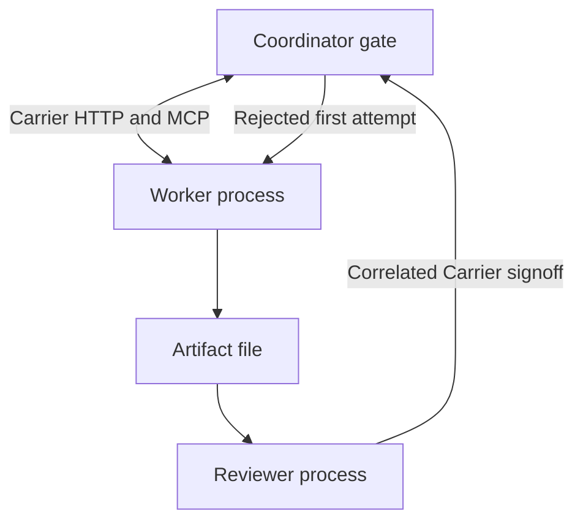

# Gate an artifact with two native agents

Run two distinct Agent Manager executions with separate profiles and Carrier identities. One produces an actual file; the other independently reads and verifies its bytes. The application accepts the artifact only after checking a correlated reviewer response and the file itself. A deliberately wrong first artifact makes the rejection path visible.

This walkthrough uses a deterministic **fake native Codex CLI**, not a model. Worker and reviewer actions are explicit Python fixture operations. The lifecycle hook, injected Carrier MCP tools, HTTP service, Agent Manager SDK, and Undercurrent sessions are real. This verifies local transport and acceptance policy, not reasoning quality, real inference, or vendor compatibility.



Both native processes run concurrently in distinct Undercurrent sessions. Their work is ordered deliberately: the reviewer reads only after the worker's correlated response. Separate profiles identify separate execution environments; this is not an operating-system security boundary.

## Run the program

Complete [connected setup](connected-setup.md). From the **manager-suites checkout**, use its prepared Python environment and set `RUNTIME_BIN` to the matching native binaries directory. Choose an unused short work directory.

```sh
python docs/examples/connected/parallel_gate.py --work /tmp/gate-demo --runtime-bin "$RUNTIME_BIN"
```

The program isolates configuration, the registry, `AGENT_MANAGER_HOMES_ROOT`, Carrier credentials, and runtime data beneath that directory. It creates fresh `worker` and `reviewer` profiles and never logs into a provider. [parallel_gate.py](parallel_gate.py) is the full runnable program; [native_fixture.py](native_fixture.py) implements the plainly labeled fixture. The fixture parses the injected native MCP definition and invokes its actual `bind_conversation` lifecycle hook before using messaging tools.

## Apply the acceptance policy

This is the `acceptance-gate` source excerpt. The surrounding code launches and tracks both processes, checks distinct session/environment/address identities, and opens the coordinator's Carrier SDK client.

```python
for attempt in [1, 2]:
    task = f'revenue-{attempt}'
    for role, agent, identity, action in zip(
            ['worker', 'reviewer'], [worker, reviewer], identities, ['produce', 'review']):
        message = await request(inbox, app, task + '-' + role, identity['address'],
            dict(task=task, action=action, artifact=str(artifact), attempt=attempt))
        await trigger(agent, app, task + '-' + role, dict(request_id=message.id,
                      sender=app.addresses['coordinator'], task=task))
        reply = await checked_reply(inbox, message, identity['address'], task)
        result = reply.json()
        save_json(app.root / (task + '-' + role + '-accepted.json'), reply.to_dict())
        await reply.ack()
        if role == 'worker':
            worker_digest = result['sha256']
    data = artifact.read_bytes()
    digest = hashlib.sha256(data).hexdigest()
    accepted = (data == EXPECTED and result['status'] == 'accepted'
                and result['sha256'] == digest == worker_digest)
    save_json(app.root / (task + '-gate.json'), dict(accepted=accepted, sha256=digest,
              reviewer=reply.sender, reply_to=reply.reply_to, request_id=message.id))
    show('gate', attempt=attempt, accepted=accepted, reviewer_status=result['status'])
    assert accepted == (attempt == 2)
```

`request` saves exact destination, content, and sender-scoped message key before mutation. It retries the identical send and requires the original numeric ID. `trigger` saves terminal delivery intent and checks a duplicate delivery receipt on replay. `checked_reply` bounds the wait, checks expected sender, numeric request correlation, and task ID, and observes acknowledgment of the original request.

The fixture owns each native inbox. It checks the coordinator sender and task, saves its reply intent durably, sends through MCP, then acknowledges. The coordinator persists each validated message before acknowledging its own inbox. A rejected reviewer response can be accepted as an application record without accepting the artifact.

## Check rejection and success

Captured terminal output:

```text
gate: {"accepted": false, "attempt": 1, "reviewer_status": "rejected"}
gate: {"accepted": true, "attempt": 2, "reviewer_status": "accepted"}
stopped: {"native_executions": 2}
```

The worker first writes `Net revenue: 0.00` and the reviewer rejects it. The second attempt writes the exact bytes `Net revenue: 1175.00\n`. The final application gate independently reads `report.txt`, compares those bytes, hashes them, and matches both worker digest and reviewer digest. The captured accepted digest is:

```text
f1aa3994939d131f38eca835574cb024d3283e3adf6ec99e2c6886a29b88cca1
```

Inspect `actors.json`, both `*-launch.json` files, `revenue-1-gate.json`, `revenue-2-gate.json`, the four `*-accepted.json` envelopes, and `report.txt`. Native PID/thread records demonstrate two actual processes. A file or launch receipt alone cannot satisfy this gate.

## Retry and clean up

The demonstrated correction uses a new task/request identity because its content changes. Transport retries reuse the original saved identity and content. Do not change an existing key's body or retarget an uncertain launch. A timeout leaves evidence to inspect; the program does not fabricate approval or provide automatic coordinator-crash resume.

The fixture's file overwrite is deterministic and repeatable. A crash between writing bytes and saving reply intent can repeat that overwrite; the example makes no exactly-once side-effect promise. Reviewer isolation is procedural, not adversarial. After verification, both executions are explicitly stopped and their bindings reconciled. The shared context stops Carrier and the daemon, retaining evidence. Check `cleanup.json` for two true cleanup fields and an empty `failures` list.
