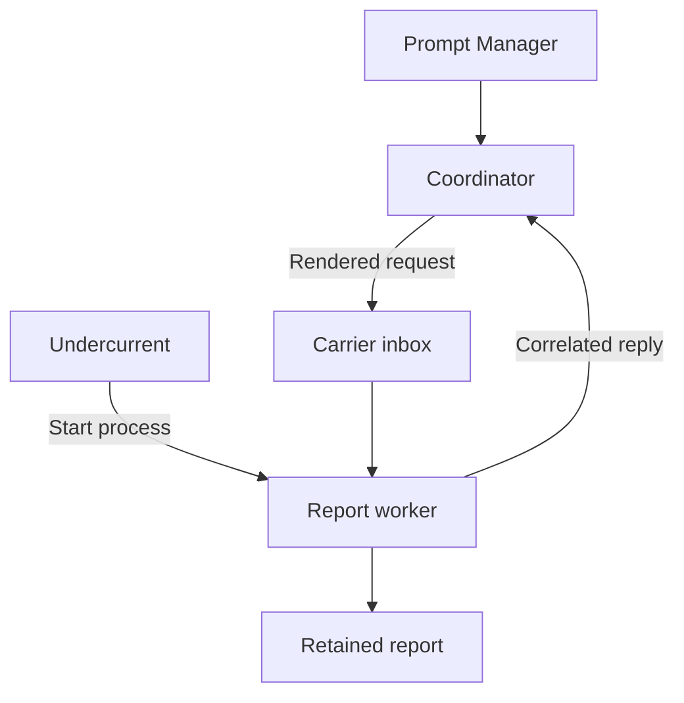

# Send a rendered request to a report worker

Produce a paid-invoice report through three SDKs: Prompt Manager captures the
instructions, Carrier retains the request and reply, and Undercurrent runs the
worker as a separate process. The report totals two paid invoices at **15,250
cents** and excludes a 9,000-cent unpaid invoice. This makes successful delivery
visible as an application result rather than a process-start receipt.

The worker is deliberately a small finance application. It verifies the expected
instruction and computes the report locally; it does not claim natural-language
reasoning or send any model requests.



## Run the application

Complete [connected setup](connected-setup.md). Run from the Manager Suite checkout
on Linux with its activated SDK environment, matching runtime binaries and a
fresh, short work directory. This example uses deterministic application code;
it makes no model calls.

```sh
python docs/examples/connected/prompt_worker.py --work /tmp/connected-report --runtime-bin "$RUNTIME_BIN"
```

[The complete program](prompt_worker.py) uses [resource_worker.py](resource_worker.py)
and the shared [runtime](connected_runtime.py). Infrastructure starts a private
Undercurrent daemon and a real Carrier HTTP service in a managed session. Carrier
binds a dynamically selected loopback port. Separate credentials identify the
coordinator and worker; only the worker reads the worker inbox.

## Follow the SDK handoff

This exact `report-request` excerpt needs its surrounding async program:

```python
manager = Manager(home=app.root / 'prompts', packs=[])
created = manager.create_managed('report', content='Report paid invoice totals in cents.')
package = manager.package('local', 'report')
rendered = package.render('report', revision=created['revision'], format='messages')
payload = {'task': 'paid-report', 'kind': 'report', 'revision': created['revision'],
           'prompt': rendered['output'], 'invoices': [
               {'cents': 12500, 'paid': True}, {'cents': 2750, 'paid': True},
               {'cents': 9000, 'paid': False}]}
intent = {'sender': app.addresses['coordinator'], 'to': app.addresses['worker'],
          'key': 'paid-report-request', 'payload': payload}
save_json(app.root / 'delivery-intent.json', intent)
async with app.client('coordinator') as inbox:
    request = await inbox.send_json(payload, to=intent['to'], idempotency_key=intent['key'])
    await launch(app, app.root / 'delivery-intent.json')
    reply = await inbox.wait_for_reply(request, timeout=10, poll_interval=.05)
    assert reply.sender == intent['to'] and reply.reply_to == request.id
    result = reply.json()
    assert result['task'] == payload['task'] and result['total_cents'] == 15250
    assert result['paid_count'] == 2 and result['prompt'] == rendered['output']
    save_json(app.root / 'accepted-reply.json', reply.to_dict())
    await reply.ack()
    assert (await inbox.delivery_status(intent['key']))['status'] == 'acknowledged'
```

The request carries the prompt revision and rendered messages, not a mutable
package reference alone. The worker independently renders that historical revision
and checks the bytes against the queued messages. It validates the authenticated
sender, destination, request key and full task payload before accepting work.
[Prompt rendering](../../../prompt-manager/docs/python-sdk.md) owns revision behavior;
[Carrier correlation](https://github.com/Aixand/carrier/blob/main/carrier/sdk.py)
owns reply selection. Undercurrent's terminal lifecycle is checked separately from
the application assertions.

## Inspect the verified result

Captured from a real run, with exit status zero:

```text
Report verified: {"correlated": true, "paid_count": 2, "request_acknowledged": true, "total_cents": 15250}
```

The program checks arithmetic, paid count, prompt equality, expected reply sender,
`reply_to`, task identity, and the saved report's Carrier message ID. Inspect
`/tmp/connected-report/paid-report-result.json` and `accepted-reply.json` for the
independent application and messaging evidence. `worker-session.json` records the
observed terminal snapshot, and `worker.log` retains bounded process output.

## Handle a failure and clean up

A bad instruction, mismatched task, or unexpected sender stops the worker without
acknowledging the request. Inspect its log and saved intent before deciding whether
to retry. The worker saves its application result before replying or acknowledging;
the coordinator saves its accepted reply before acknowledging it. Neither a launch
receipt nor an acknowledgment alone establishes a correct report.

Context exit stops only owned sessions, closes the bridge, and stops the private
daemon. Check `cleanup.json` for `owned_sessions_stopped: true`, an empty failure
list, and `daemon_exited: true`. Evidence and private credentials remain in the
work directory. Remove that exact disposable directory after review. Use the
[frozen prompt walkthrough](frozen-prompt.md) for the controlled interruption and
same-identity replay boundary; this command does not demonstrate a daemon restart.
