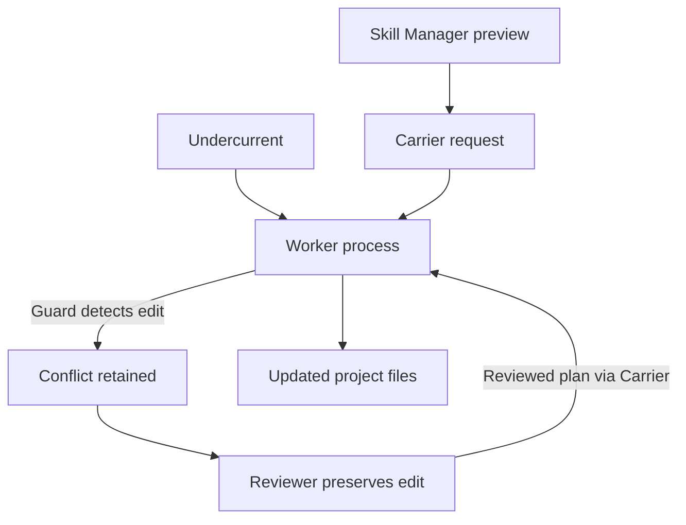

# Roll out a reviewed invoice policy skill

Deliver a native finance skill and its concrete `config.json` to a project through
Carrier and an Undercurrent worker. Then introduce a local project edit and show
that Skill Manager rejects a previously reviewed update instead of overwriting
it. Preserve the edit, explicitly review the desired policy, restore the installed
base and apply a newly previewed update. The final configuration adds a
**1,000-cent minimum** while keeping unpaid invoices excluded.

This is local skill delivery, not execution of the skill by a model. The reviewer
is a deterministic scripted fixture with its own Carrier identity; the example
does not claim human approval or provider qualification.



## Run the rollout

Complete [connected setup](connected-setup.md). Run from the Manager Suite checkout
on Linux with its activated SDK environment, matching runtime binaries and a
fresh, short work directory. This example uses deterministic application code;
it makes no model calls.

```sh
python docs/examples/connected/skill_rollout.py --work /tmp/connected-skill --runtime-bin "$RUNTIME_BIN"
```

The [program](skill_rollout.py) creates a native `SKILL.md` plus configuration,
registers it with `skill.register`, previews delivery with `project.preview_connect`,
and sends the unchanged plan to [resource_worker.py](resource_worker.py). Preview
must leave the project target absent. The worker calls `project.connect(plan)`;
the coordinator checks installed file bytes against the publisher's captured bytes.
Three independent worker processes handle installation, conflict, and reviewed
update. Each exits before the next starts, retaining one inbox owner.

## Preserve a project edit before updating

This exact `reviewed-rollout` excerpt needs the surrounding async program:

```python
skill.save({'config.json': FileContent(new)}, expected_revision=captured.revision)
pending = project.preview_update()
save_json(app.root / 'reviewed-plan-before-edit.json', pending)
local = b'{"include_unpaid": true, "currency": "PHP"}\n'
target.write_bytes(local)
rejected = await deliver(app, 'stale-update', 'update', pending)
assert rejected['status'] == 'conflict' and target.read_bytes() == local
# This deterministic reviewer fixture explicitly preserves and sets aside the edit.
(app.root / 'retained-project-config.json').write_bytes(target.read_bytes())
save_json(app.root / 'review-decision.json', {
    'actor': 'local scripted reviewer; no model or human approval claimed',
    'decision': 'Preserve local edit; restore installed base; apply accepted minimum threshold',
    'old': old.decode(), 'local': local.decode(), 'new': new.decode()})
target.write_bytes(old)
reviewed = project.preview_update()
save_json(app.root / 'reviewed-update-plan.json', reviewed)
assert target.read_bytes() == old
updated = await deliver(app, 'reviewed-update', 'update', reviewed, role='reviewer')
assert updated['status'] == 'completed' and target.read_bytes() == new
repeated = project.apply_update(reviewed)
assert repeated['id'] == updated['operation_id'] and repeated['status'] == 'completed'
assert (app.root / 'retained-project-config.json').read_bytes() == local
```

`skill.save` changes accepted library content under a revision guard. It does not
change an existing project connection. The saved project plan pins desired content
and observed project state. The edit makes apply fail with `conflict`. The worker
only accepts a known, non-uncertain conflict as a retained application result;
other errors stop execution for inspection.

See [project delivery](../../../skill-manager/docs/project-delivery.md),
[public SDK methods](../../../skill-manager/src/skill_manager/sdk.py), and
[apply guards and receipts](../../../skill-manager/src/skill_manager/projects.py).

## Inspect the verified result

Captured terminal output, exit zero:

```text
Skill rollout verified: {"conflict_preserved_edit": true, "installed_config": {"currency": "PHP", "include_unpaid": false, "minimum_cents": 1000}, "local_edit_retained": true, "reviewed_update": "completed", "same_operation_on_replay": true}
```

Inspect `/tmp/connected-skill/project/skills/invoice-policy/config.json` and
`retained-project-config.json`: the first contains the reviewed threshold; the
second retains the rejected local `include_unpaid: true` edit. `review-decision.json`
records the fixture's old, local and desired content. Saved `*-intent.json`,
`*-result.json` and `*-accepted.json` files retain request, worker acceptance and
correlated reply evidence. Each reply must match its expected sender, task and
request ID before acknowledgment. `project-operations.json` retains SDK operation
receipts. Reapplying the completed plan must return its original operation ID.

## Recover and clean up

Restoring the installed base is an explicit policy choice after preserving the
local edit; it is not an automatic conflict resolver. A newly previewed plan can
have the same token when its complete inputs match. Replaying an SDK plan uses
its existing operation identity. This example tests guard rejection and completed
operation replay, not interruption inside Skill Manager's file-move journal.
For uncertain operations, inspect `project.operations()` and use the SDK's explicit
recovery procedure before another mutation. No transaction spans Carrier and
project files, and no exactly-once external side effect is promised.

Context exit closes clients and stops the owned worker sessions, Carrier service,
bridge and private daemon. Verify `cleanup.json` reports no failures. Evidence,
local credentials and project files remain for inspection; remove only the chosen
disposable work directory after review.
