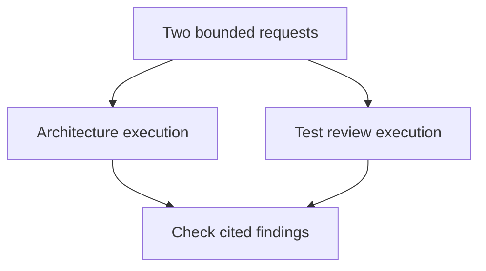

# Review a project with two persistent agents

Each native execution receives its own retained input; checking the resulting findings is a separate acceptance step.

## Follow the SDK boundary



Each native execution receives its own retained input; checking the resulting findings is a separate acceptance step. The excerpt below is from the runnable script; its setup and surrounding checks remain in that script.

```python
await agent.wait(
    lifecycle="running", interaction="available", timeout=args.timeout
)
receipt = await agent.send_input(**delivery)
write_json(state / f"receipt-{args.input_id}.json", asdict(receipt))
print(json.dumps({"input_receipt": asdict(receipt)}))
```

Continue with [a parallel artifact acceptance gate](connected/parallel-gate.md) to connect this boundary to Carrier delivery, Undercurrent execution and a checked application result.

## Prerequisites

Complete [launch and recovery setup](persistent-agents.md) and save its `managed_agent.py` download. Use two authenticated profiles, `work` and `review`, or substitute your own. For separate native homes, create separate environments and authenticate each. An alias of `work` shares its native home; it does not provide a second isolated account.

Use a disposable checkout or a project you want reviewed. These requests ask for observation only. Provider permission settings still govern actual access, and each model turn consumes the selected account's allowance.

## Prepare two bounded requests

Save `architecture.txt`:

```text
Review this project's architecture. Do not edit files or run installs.
Identify its main entry points, module boundaries, and one coupling risk.
Cite a real file path for every finding. Distinguish observations from guesses.
```

Save `tests.txt`:

```text
Review this project's tests. Do not edit files or run installs.
Identify three important behaviors with weak or missing coverage, citing the
implementation and relevant tests. Propose checks; do not claim tests ran.
```

## Launch both executions

```sh
python managed_agent.py launch --state reviews/architecture \
  --profile work --project /absolute/path/to/project
python managed_agent.py launch --state reviews/tests \
  --profile review --project /absolute/path/to/project
```

The first execution remains alive while the second starts. Inspect both state directories and attach to each printed Undercurrent session to resolve native setup prompts. Each has its own retained launch UUID and execution reference.

## Dispatch the reviews

Once both terminals are ready:

```sh
python managed_agent.py send --state reviews/architecture \
  --message-file architecture.txt --input-id review
python managed_agent.py send --state reviews/tests \
  --message-file tests.txt --input-id review
```

Both agents can now work independently. The second send does not wait for the first agent to complete. If a terminal is waiting for trust or authentication, resolve that prompt before retrying its saved input.

## Collect and check findings

```sh
python managed_agent.py inspect --state reviews/architecture
python managed_agent.py inspect --state reviews/tests
python managed_agent.py screen --state reviews/architecture > architecture-screen.txt
python managed_agent.py screen --state reviews/tests > tests-screen.txt
```

Read the actual responses, follow their cited paths, and check that each reviewer addressed its assigned questions. An idle terminal or screen capture alone does not prove that the requested review is complete. For longer output, attach to the session or use retained Undercurrent output with the SDK's offset/gap handling.

To request a correction, save a new prompt file and send it to the same execution with a distinct `--input-id`. Preserve its state directory. `retry-launch` is for recovery of an uncertain launch; it is not a command to restart completed work.

## Stop the exact executions

```sh
python managed_agent.py stop --state reviews/architecture
python managed_agent.py stop --state reviews/tests
```

This workflow runs two independent native agents and leaves review acceptance to you. To make agents exchange questions, replies, and explicit sign-off, continue with [Carrier-coordinated review](https://projects.aixand.org/carrier/examples/agentic-review/).

## Validation

The earlier site walkthrough records the live evidence below. It is not a fresh
authenticated qualification of this documentation revision.

Tested on Linux with two live Codex 0.166.0 executions using the walkthrough’s architecture and test-review prompts against a small Python project. Both returned findings citing the fixture’s actual files, and both recorded executions were explicitly stopped. The test used two executions of one authenticated profile.
