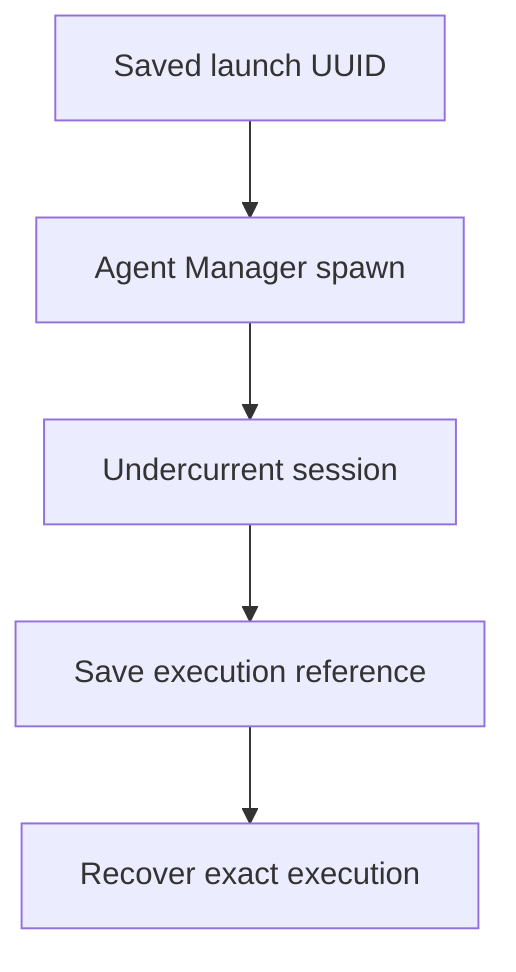

# Launch and recover an agent with Undercurrent

The utility saves the launch intent and execution reference separately, then recovers that same execution with the SDK.

## Follow the SDK boundary



The utility saves the launch intent and execution reference separately, then recovers that same execution with the SDK. The excerpt below is from the runnable script; its setup and surrounding checks remain in that script.

```python
agent = await agents.get(
    json.loads((state / "reference.json").read_text())
)
```

Continue with [a native task mailbox](connected/agent-mailbox.md) to connect this boundary to Carrier delivery, Undercurrent execution and a checked application result.

## Prerequisites

Complete [connected setup](https://projects.aixand.org/undercurrent/docs/guides/connected-examples/) and install Agent Manager's SDK into that Python environment. From the sibling checkout parent:

```sh
python -m pip install ./aixand-libraries/local-runtime './manager-suites/agent-manager[sdk]'
```

Then return to `connected-demo`, with the same environment active and `UNDERCURRENT_HOME` selected. Install and authenticate a Codex profile using [Agent Manager setup](../../agent-manager/docs/README.md). These examples use the profile `main`; substitute an existing alias. Model requests use your provider account.

Save `managed_agent.py` from the download above. Run its commands serially for each state directory. The utility persists launch and input intents before dispatch; each state directory belongs to one execution and must be kept private.

## Launch from your project

```sh
python managed_agent.py launch --state native-agent \
  --provider codex --profile main --project /absolute/path/to/project
```

`native-agent` must not exist. The output contains an execution reference and observed state. The script exits and leaves the native process running inside Undercurrent. Its `intent.json` retains the launch UUID, provider selection, original runtime connection, and absolute project path; `reference.json` records the exact run and session identities.

This walkthrough and its downloadable utility target Codex. Native provider capabilities and detection support vary.

## Inspect, attach, and detach

```sh
python managed_agent.py inspect --state native-agent
python managed_agent.py screen --state native-agent
```

Copy the `session_id` from `native-agent/reference.json`:

```sh
uc attach SESSION_ID
```

Resolve any project trust, login, or permission prompts in that terminal. Detach with **Alt-U**, release it, then **d**. Run the inspect command again from a new Python process. It must observe the same run/session IDs, rather than start a replacement.

CLI `runtime = "direct"` preferences do not change this workflow: Agent Manager's async execution SDK always uses Undercurrent. No provider TOML change is required for the SDK.

## Send one retained task

Create `task.txt` containing a bounded request, for example:

```text
Read this project's entry points and explain how a request reaches its main
implementation. Cite existing file paths. Do not edit files or run installs.
```

```sh
python managed_agent.py send --state native-agent --message-file task.txt --input-id architecture
```

The utility waits for an available native terminal, saves the input text and a delivery UUID, and sends it once. A retry with the same input ID and bytes reuses that delivery UUID; changed text is rejected. For a new follow-up, choose another `--input-id`.

The printed input receipt confirms terminal delivery. Inspect the response and verify its cited files yourself; readiness or a delivered prompt does not establish task completion. Save an inspection snapshot if useful:

```sh
python managed_agent.py screen --state native-agent > architecture-screen.txt
```

A screen snapshot can be truncated and include terminal escape sequences. It is not the full conversation or a durable task-result protocol. Use the [Carrier worker/reviewer workflow](https://projects.aixand.org/carrier/examples/agentic-review/) for explicit completion messages and an artifact check.

## Recover an uncertain launch

If dispatch failed or its response was lost, retain `intent.json` and use:

```sh
python managed_agent.py retry-launch --state native-agent
```

This reuses the saved launch UUID and arguments. It does not create a new task or resume historical conversation in another process. Inspect the outcome before sending input again. Once the reference is available, normal `inspect`, `screen`, and `stop` recover through `agents.get(reference)`.

A wait timeout leaves the process running. Do not delete its state directory or launch a replacement merely because a reply was lost.

## Stop explicitly

```sh
python managed_agent.py stop --state native-agent
python managed_agent.py inspect --state native-agent
```

Expect a terminal lifecycle such as `stopped` or `exited`. Keep the local evidence until you finish reviewing it. Closing the utility, its Agent Manager client, or its borrowed Undercurrent connection only detaches.

Continue with [parallel reviewers](parallel-reviews.md) or [a Carrier-connected worker and reviewer](https://projects.aixand.org/carrier/examples/agentic-review/).

## Validation

The earlier site walkthrough records the live evidence below. It is not a fresh
authenticated qualification of this documentation revision.

Tested on Linux with live Codex 0.166.0: the downloaded utility launched a native execution, recovered it from another process, delivered a bounded arithmetic request, observed the actual model response, and stopped the execution. The offline verifier additionally checks repeated launch UUIDs and terminal input delivery IDs.
