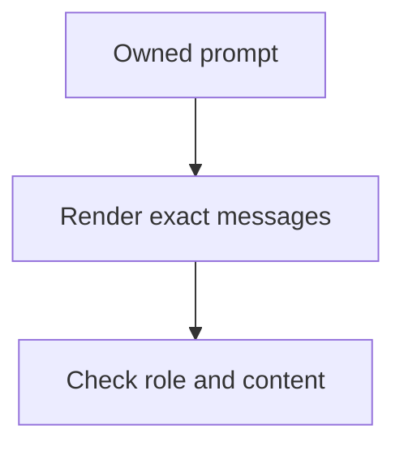

# Render an owned prompt

The manager returns messages; the application decides when and where to dispatch them.

## Follow the SDK boundary



The manager returns messages; the application decides when and where to dispatch them. The excerpt below is from the runnable script; its setup and surrounding checks remain in that script.

```python
manager = Manager(home=Path(temporary) / "prompts", packs=[])
created = manager.create_managed(
    "review", content="Review carefully and check missing tests.", role="system"
)
rendered = manager.render_managed("local", "review", "review", format="messages")
assert rendered["output"] == [
    {"role": "system", "content": "Review carefully and check missing tests."}
]
assert created["id"] == "review"
```

Continue with [a queued report worker](connected/prompt-worker.md) to connect this boundary to Carrier delivery, Undercurrent execution and a checked application result.

## Prerequisites

Complete [full-suite source setup](../getting-started/installation.md#set-up-the-complete-suite) and activate `.venv`. Run from the `manager-suites` repository root. Save the download as `render-prompt.py` in your working directory. The script uses a temporary store and requires no provider credentials.

## Run the example

```sh
python render-prompt.py
```

The script creates an owned `local/review` prompt, renders messages, and checks the role and content. Expect a message list containing `Review carefully and check missing tests.` No model is called.

## Runnable source

Read [render-prompt.py](scripts/render-prompt.py) for the complete executable example.

## Verify and clean up

The assertions stop with an error if the expected outcome is not observed. On success, the script prints its checked result. Temporary files are removed automatically when it finishes; default manager stores are untouched.

If imports fail, check your active Python environment. For operation conflicts or missing live tools, follow [troubleshooting](../troubleshooting.md).
