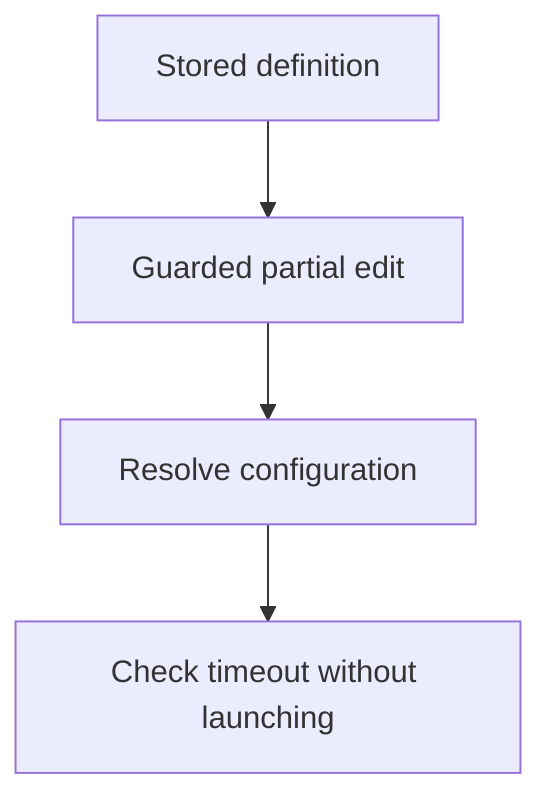

# Resolve an MCP definition

Resolution selects connection configuration; the consumer owns the later transport and tool call.

## Follow the SDK boundary



Resolution selects connection configuration; the consumer owns the later transport and tool call. The excerpt below is from the runnable script; its setup and surrounding checks remain in that script.

```python
created = manager.add("docs", {"command": sys.executable, "args": [str(server)]})
updated = manager.configure("docs", {"tool_timeout_sec": 90},
                            expected_revision=created["revision"])
resolved = manager.resolve(["docs"], str(root), project=None, check=False)
assert resolved["servers"]["docs"]["tool_timeout_sec"] == 90
assert updated["revision"] != created["revision"]
```

Continue with [a recoverable MCP inventory job](connected/mcp-job.md) to connect this boundary to Carrier delivery, Undercurrent execution and a checked application result.

## Prerequisites

Complete [full-suite source setup](../getting-started/installation.md#set-up-the-complete-suite) and activate `.venv`. Run from the `manager-suites` repository root. Save the download as `resolve-mcp.py` in your working directory. The script uses a temporary store and requires no provider credentials.

## Run the example

```sh
python resolve-mcp.py
```

The definition points at a temporary script that raises if executed. The script updates its timeout using the observed revision, then resolves it with health checking disabled. Expect `selected` to contain `docs`, `tool_timeout_sec` to be `90`, and `server_started` to be `false`. This verifies configuration selection, not live server health.

## Runnable source

Read [resolve-mcp.py](scripts/resolve-mcp.py) for the complete executable example.

## Verify and clean up

The assertions stop with an error if the expected outcome is not observed. On success, the script prints its checked result. Temporary files are removed automatically when it finishes; default manager stores are untouched.

If imports fail, check your active Python environment. For operation conflicts or missing live tools, follow [troubleshooting](../troubleshooting.md).
