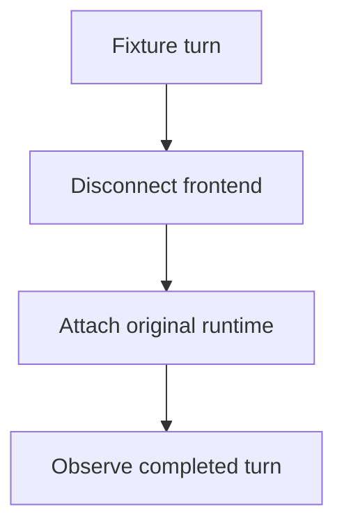

# Reconnect to retained conversation work

The fixture demonstrates retained runtime identity and an observed terminal event, independently of model inference.

## Follow the SDK boundary



The fixture demonstrates retained runtime identity and an observed terminal event, independently of model inference. The excerpt below is from the runnable script; its setup and surrounding checks remain in that script.

```python
result = await demo()
assert result["status"] == "completed"
assert result["reattached_same_runtime"] is True
assert any(event["kind"] == "turn.completed" for event in result["events"])
```

Continue with [an inbox-backed retained conversation](connected/conversation-jobs.md) to connect this boundary to Carrier delivery, Undercurrent execution and a checked application result.

## Prerequisites

Complete [full-suite source setup](../getting-started/installation.md#set-up-the-complete-suite) and activate `.venv`. Run from the `manager-suites` repository root. Save the download as `retained-conversation.py` in your working directory. The script uses a temporary store and requires no provider credentials.

## Run the example

```sh
python retained-conversation.py
```

The script uses the source checkout's built-in demo fixture. It sends work, disconnects a frontend, reattaches to the same runtime, observes `turn.completed`, and terminates the worker. Expect `status` to be `completed`, with `reattached_same_runtime` and `turn_completed` set to `true`. No live provider or model participates.

## Runnable source

Read [retained-conversation.py](scripts/retained-conversation.py) for the complete executable example.

## Verify and clean up

The assertions stop with an error if the expected outcome is not observed. On success, the script prints its checked result. Temporary files are removed automatically when it finishes; default manager stores are untouched. The retained-conversation script also terminates its fixture worker.

If imports fail, check your active Python environment. For operation conflicts or missing live tools, follow [troubleshooting](../troubleshooting.md).
