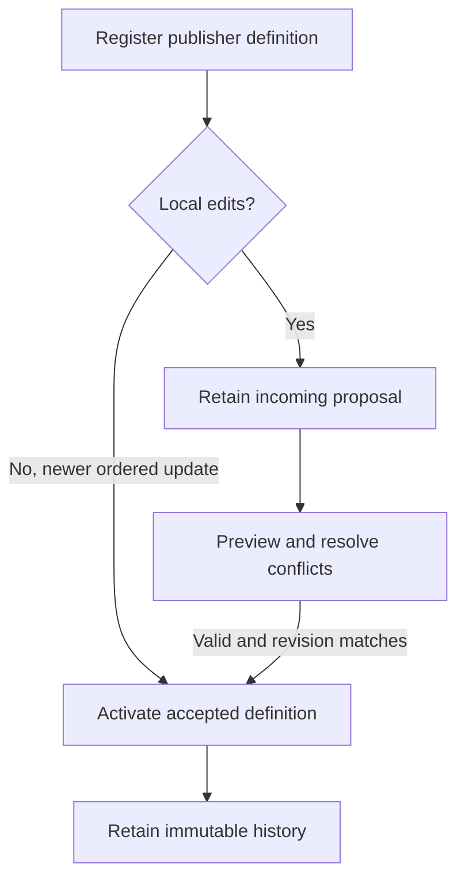

# Owned MCP definitions

This development branch owns immutable configurations and publisher reconciliation.
Applications select accepted definitions and deliver them through their own MCP
clients or native configuration adapters. These APIs work without Suite, Agent
Manager, or a backend; Agent Manager does not attach resources at launch.

## Review publisher changes

This is the acceptance boundary; installation and running connections remain separate.



```python
from mcp_manager import Manager
m = Manager()
status = m.ensure_registered("docs", {"command": "docs-mcp", "args": [],
    "env_vars": ["DOCS_TOKEN"]}, server_id="default", publisher_revision=12, version="1.4")
accepted = m.resolve_managed("docs", "default")
```

Call ensure once during consumer startup (and explicitly again to refresh).
Identical registration is idempotent. Newer nonnegative integer publisher revisions
auto-activate only when the copy has no edits. Customized copies keep their accepted
configuration and expose `reconciliation_required`. Unversioned changed content
requires review. Older revisions are ignored; reusing a revision for different
content conflicts. Display versions do not establish ordering. Pausing tracking
retains the copy and prevents subsequent registration from changing it. Invalid
incoming definitions retain accepted content and report `sync_error`.

Each state has an active digest, publisher baseline, incoming publisher snapshot,
guarded state revision and immutable history. Definition objects live in
`objects/`, active state in `managed/PUBLISHER/SERVER.json` and state history in
`managed-history/PUBLISHER/SERVER/`. Writes publish immutable objects/history before
atomically switching active state under the managed lock. Read-only inspection of
an absent store writes nothing. Accepted copies do not require original publisher
files. Commands, external scripts and server software are referenced, not copied;
environment values are resolved at execution and are never stored by these APIs.

```python
edited = m.save_managed("docs", "default", {"command": "docs-mcp", "args": ["--local"]},
    expected_revision=status["revision"])
preview = m.preview_reconciliation("docs", "default")  # after an incoming update
m.reconcile("docs", "default", expected_revision=preview["revision"], take="managed")
```

Save replaces the complete definition. Reconciliation makes a structural three-way
proposal: scalar strings are values and arrays are atomic. JSON-pointer conflict
choices support `take=managed|publisher|baseline`, a replacement `value`, or delete.
A candidate must be valid and every conflict resolved before activation. Taking
managed content acknowledges the incoming baseline so the same update does not
reappear. Preview never mutates content; newer edits/updates invalidate its revision.
History/rollback preserve current publisher tracking and pending updates.

## CLI

```sh
mcp-manager managed ensure docs default --definition @server.json --publisher-revision 12
mcp-manager managed list
mcp-manager managed status docs default
mcp-manager managed resolve docs default --revision sha256:HISTORICAL_STATE
mcp-manager managed save docs default --definition @edited.json --expected-revision STATE
mcp-manager managed preview docs default
mcp-manager managed apply docs default --take managed --expected-revision STATE
mcp-manager managed apply docs default --resolutions @choices.json --expected-revision STATE
mcp-manager managed history docs default
mcp-manager managed rollback docs default OLD_STATE --expected-revision STATE
mcp-manager managed tracking docs default off --expected-revision STATE
mcp-manager managed inspect docs default --cwd /project --project /project
mcp-manager managed adopt vendor default --legacy-name docs --definition @publisher.json --publisher-revision 12
mcp-manager managed prepare sonar default --project /project --background
mcp-manager managed refresh sonar default --project /project --settings '{"resolve":true}'
```

## Deliver accepted definitions from an application

Choose the MCP store with `Manager(home=...)`. Use
`resolve_managed(publisher, server_id, revision=...)` to read an accepted definition
or retained historical state. Use `inspect_managed(publisher, server_id, cwd,
revision=...)` to resolve executable/preparation readiness for that managed target.
These operations do not launch or attach a server. A pending publisher update does
not block reading a usable accepted copy.

Your application owns selection policy, required/optional handling, captured client
configuration, and delivery to its runtime. It must enforce readiness and authorization
before starting a client. Retaining a configuration does not establish a live connection.

The former `agent codex mcp managed` delegation, resource-request-2 launch flags,
and binding-3 delivery claims are retired Agent integration, not current MCP APIs.
Do not use those commands. See the current
[Agent resource boundary](../../agent-manager/docs/resource-separation.md) and
[historical notes](DISCUSSION.md#retired-managed-consumer-notes) for migration context.

## Adoption and preparation

Local definitions remain user-owned until explicitly adopted.
Adoption imports their current content without inventing a publisher baseline.
When imported and publisher configurations differ, explicit review establishes the
baseline. There are no bundled Sonar/Lore definitions or initialization command.
Users install server software themselves and register definitions explicitly with
`managed ensure` or adopt their saved definitions with `managed adopt`.
`bootstrap_defaults()` is a no-op. Managed targets
are selected explicitly by the consuming application. Local
configuration commands cannot edit managed
state; managed edits always require the observed revision.

Managed Sonar/Lore preparation uses separate per-publisher/server project namespaces
with ordinary retained jobs in the same store. Preparation captures definitions and
requested revisions. The index fingerprint excludes startup/tool timeouts and cwd;
timeout-only edits reuse compatible generations. Manifests without the
index fingerprint keep their conservative full-definition comparison. Failed refresh
preserves the previous published generation. Reconnect preserves a running session's
selected configuration. This connector API does not expose live attach/detach;
a consumer needs its own supported backend mechanism for such changes.
Preparation supports stdio servers; install executable dependencies separately.


Direct creation, public GitHub sources and retained import jobs are documented in
[source imports](sources.md).

## Owning implementation

See [library service](../src/mcp_manager/library/service.py),
[reconciliation](../src/mcp_manager/library/reconciliation.py), and
[managed lifecycle tests](../tests/test_managed.py). These tests cover ordered and
unordered updates, atomic array conflicts, paused tracking, history, adoption,
and competing saves.
