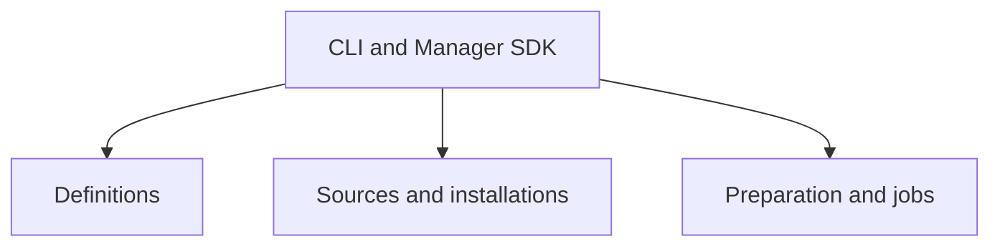
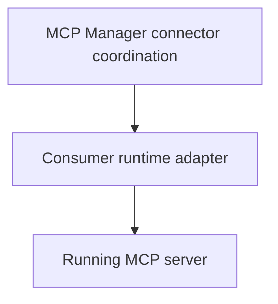

# Understand state ownership

Use this map to find the owner before changing storage or adding an integration.
This describes the development branch, not the roadmap in [DISCUSSION](DISCUSSION.md).

Live transport has a separate consumer owner:

| State or action | Owner |
| --- | --- |
| Accepted definitions, revisions, history, artifacts | MCP library |
| Discovery bytes, provenance, installed generations | MCP source and installation services |
| Project index manifests, preparation receipts | MCP preparation and jobs services |
| Resource selection, composition, delivery, and captured client configuration | Consuming application |
| Running connection, authorization, tools/resources/prompts | Consumer client and server |
| Live inventory and reconnect implementation | Injected backend connector |

## Internal architecture

`manager.py` is the public SDK facade and composes services instead of inheriting
source or managed-definition mixins. CLI commands call the same SDK operations.

| Package | Responsibility |
| --- | --- |
| `library/` | Definition validation, local registry, publisher reconciliation, history, review views, artifacts, and selection resolution. |
| `storage/` | Atomic files, locking, platform primitives, and compatible metadata encodings. |
| `sources/` | MCP discovery/import/update policy, provenance, and shared GitHub acquisition adapter. |
| `installations/` | Installation recipes, package execution, retained generations, and executable resolution. |
| `preparation/` | Stage and validate project indexes; Sonar/Lore commands live in separate adapters. |
| `jobs/` | Retain preparation/source/install requests, dispatch detached workers, and inspect receipts. |
| `diagnostics/` | Bounded stdio protocol checks. |
| `live/` | Connector contracts, inventory, and selection-preserving reconnect operations. |
| `interfaces/cli/` | Argument parsing, strict JSON input, SDK dispatch, and result presentation. |

Domain modules do not import CLI code, the SDK facade, or public re-export
modules. Public module paths include `mcp_manager.cli`,
`mcp_manager.runtime`, managed helpers, and `python -m mcp_manager.jobs`. Reconnect
receipt instrumentation through the runtime module shares the canonical
implementation.

Source and installation services are native to MCP Manager. Stored source hashes
and schema identifiers remain readable without external service packages. Native
services use explicit repository/engine dependencies; accessor methods delegate
to the same services. Client/project connections and the complete
uninstall/version lifecycle are subsequent work.

Builds use a clean temporary source copy so only selected modules enter wheels.
Store operations preserve revision encodings, home selection, and generated-server
naming conventions.

`tests/test_architecture.py` checks SDK signatures, import direction, public module
exports, and worker entry points. `tests/test_standalone.py` checks the external
import boundary and runs copied sources with site packages disabled, allowing
only the two declared utilities. Source adapter tests cover local creation,
imports, and retained background jobs without network access.

## Follow a change to its tests

| Change | Start here | Evidence |
| --- | --- | --- |
| Local definition schema | [definitions](../src/mcp_manager/library/definitions.py) | [store tests](../tests/test_store.py) |
| Publisher acceptance | [reconciliation](../src/mcp_manager/library/reconciliation.py) | [managed tests](../tests/test_managed.py) |
| Runtime receipts | [live service](../src/mcp_manager/live/service.py) | [runtime tests](../tests/test_runtime.py) |
| Public API boundaries | [facade](../src/mcp_manager/manager.py) | [architecture tests](../tests/test_architecture.py) |

The earlier discussion's `resource-sources` dependency attribution is historical.
Current services are native here; retained `resource-sources/*` schema names are
compatibility identifiers, not an external runtime dependency.

## Application delivery boundary

MCP Manager returns definitions and preparation evidence. The consuming application
selects resources, retains any session configuration, and delivers it through its
own client or native configuration adapter. MCP Manager has no agent assignment API.
Agent Manager does not attach these resources or compose them at launch. Its
[target discovery boundary](../../agent-manager/docs/resource-separation.md)
exposes native environment identities for independent tools; it supplies no MCP
delivery adapter. See the [retired-surface tests](../../agent-manager/tests/test_standalone_boundary.py).
