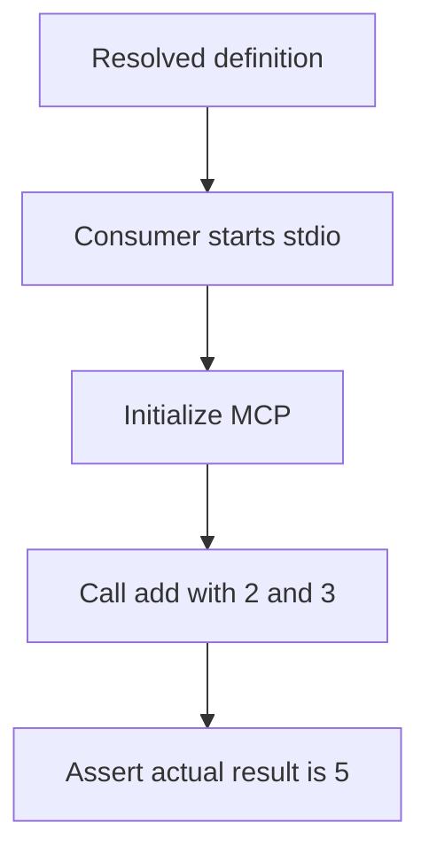

# Exercise local stdio operations

Use a real local fixture to distinguish resolved configuration from connected MCP
operations. You need Python 3.11+, MCP Manager, and the optional `mcp` Python SDK
in the same environment. The SDK is an example dependency, not a base manager
dependency. Use your application's dependency policy to install it.

## Follow the SDK boundary



The consumer starts the transport after resolution, initializes MCP and checks the actual tool result. The excerpt below is from the runnable script; its setup and surrounding checks remain in that script.

```python
parameters = StdioServerParameters(command=row['command'], args=row['args'], cwd=row['cwd'])
async with stdio_client(parameters) as (read, write):
    async with ClientSession(read, write) as client:
        await client.initialize()
        assert 'add' in [tool.name for tool in (await client.list_tools()).tools]
        called = await client.call_tool('add', {'a': 2, 'b': 3})
        assert not called.isError
        assert any(getattr(block, 'text', '') == '5' for block in called.content)
```

Continue with [a queued MCP job with replay-safe allocation](../../../docs/examples/connected/mcp-job.md) to connect this boundary to Carrier delivery, Undercurrent execution and a checked application result.

From the suite root:

```sh
python mcp-manager/examples/local_operations.py
```

[Download or inspect the single-file client and server](../../examples/local_operations.py).
The script resolves a definition first, then explicitly starts its own stdio child
through the SDK. It initializes the protocol, lists and calls `add(2, 3)`, reads
`fixture://greeting`, and retrieves the `welcome` prompt for `Reader`.

Expect a final `PASS: initialized stdio` line after assertions verify `5`,
`hello from fixture`, and `Hello, Reader!`. The SDK may also emit diagnostic logs.
The client contexts close the transport and child; the temporary manager store is
removed. A 30-second client deadline bounds the fixture run.

If imports fail, use an environment containing both packages. Protocol or content
assertions indicate a fixture/SDK compatibility problem; inspect the traceback.
No external network service, provider, credentials, or model is needed. This
qualifies the local SDK fixture only. It does not test a native backend connector,
OAuth, remote transport, or a production server.

See [connected operations](../operations.md) and the
[connector contract](../connectors.md) for ownership boundaries.
