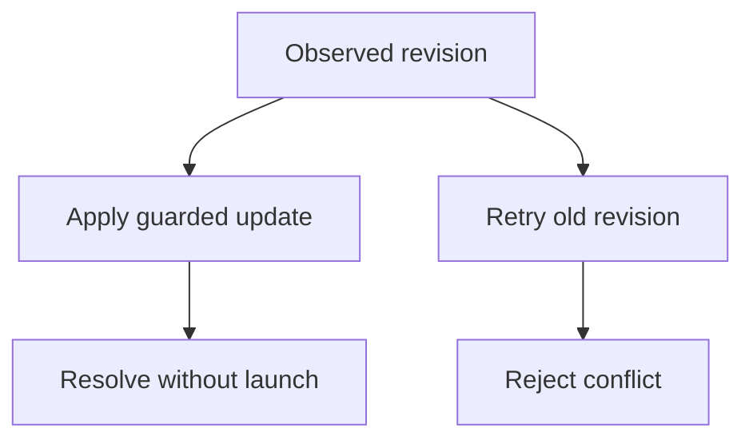

# Check revisions and mixed selections offline

Use this example to verify guarded partial updates and per-item inspection without
launching any server. Python 3.11+ and MCP Manager are required. Run from the suite
root using your installed package environment:

## Follow the SDK boundary



Expected revisions reject stale configuration writes before the application selects or launches a server. The excerpt below is from the runnable script; its setup and surrounding checks remain in that script.

```python
changed = manager.configure('offline', {'tool_timeout_sec': 90}, expected_revision=created['revision'])
assert changed['args'] == [str(server)]
try:
    manager.configure('offline', {'tool_timeout_sec': 30}, expected_revision=created['revision'])
except McpError as error:
    assert error.code == 'conflict'
else:
    raise AssertionError('stale revision accepted')
```

Continue with [a real MCP worker with durable delivery](../../../docs/examples/connected/mcp-job.md) to connect this boundary to Carrier delivery, Undercurrent execution and a checked application result.

```sh
python mcp-manager/examples/resolve_without_launch.py
```

[Download or inspect the runnable script](../../examples/resolve_without_launch.py).
It registers a script that would create a marker if run. It verifies first-occurrence
deduplication, retained args after a partial edit, rejection of a stale revision,
and continued inspection of a valid selection beside an unknown name. It then
asserts that the launch marker does not exist.

Expect `PASS: resolved without launch` followed by the checks performed. A failed
assertion exits nonzero. Temporary stores and marker fixtures are removed on exit.
The script uses no MCP SDK, server installation, provider, or model. It extends the
basic offline workflow with conflict and mixed-selection evidence.

See [resolution](../resolution.md) for home selection and project policy.
