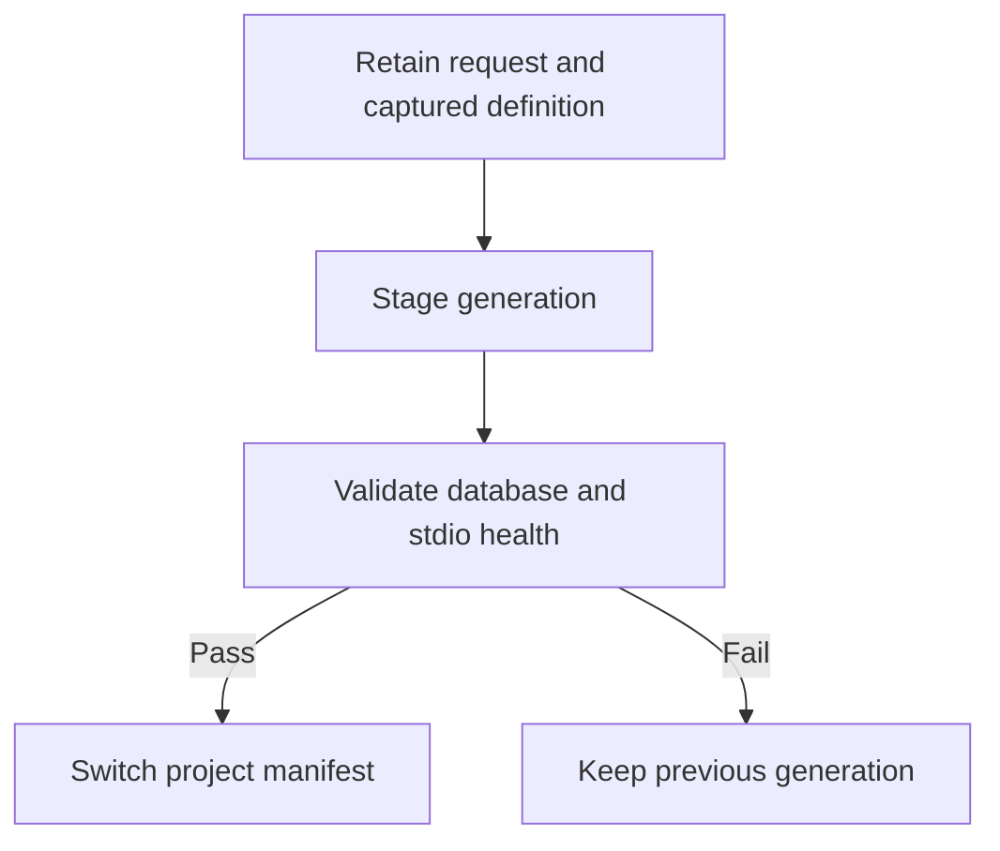

# Prepare project generations and recover jobs

Prepare only explicitly registered Sonar/Lore adapters. This operation can execute
installed server software and indexing commands. It is separate from offline
resolution and from a running client's connection.

## Preparation and freshness

After manually installing a server, register its executable and adapter explicitly:

```sh
mcp-manager add sonar --definition '{"kind":"sonar","command":"/absolute/path/to/sonar"}'
mcp-manager add lore --definition '{"kind":"lore","command":"/absolute/path/to/lore"}'
```

Default status inspection includes only registered project adapters. A fresh store
reports no project indexes, and preparation rejects unregistered servers.

```sh
mcp-manager prepare sonar lore --project /path/to/project --background --key UUID --json
mcp-manager refresh sonar --project /path/to/project --resolve --resources yaml --json
mcp-manager status --project /path/to/project --servers '["sonar"]' --check --json
mcp-manager job UUID --json
mcp-manager jobs --project /path/to/project --json
```

Preparation/refresh CLI commands wait by default. `--background` returns the
retained job immediately; library methods always return immediately. Workers run
as `python -m mcp_manager.jobs`, survive client exit, and use the initiating
interpreter. `--settings JSON` accepts `resolve`, `model_dir`, `usage_config`,
`resources` (`none`/`yaml`) and `install_model`; corresponding CLI options are
also available and override supplied settings. Model installation requires an
explicit request.

UUID keys retain the existing signature over tools, canonical project, refresh
and normalized settings. Same request returns the captured job, even after a
definition changes; changed arguments conflict. Dead recorded workers report
`interrupted` on inspection without replay or rewriting their on-disk status.
Jobs preserve recorded states and partial completed-tool results. `jobs()` retains the
existing newest-50 enumeration limit. A queued record without a PID stays
queued; inspect its log and use a new key only for a new intent.

Each tool validates its SQLite root and stdio health before publishing the
manifest atomically. Failed refresh leaves the previous prepared generation
available. Old and failed staging generations are retained. Saved session
selections continue to refer to their captured generation. Preparation and
configuration do not modify a loaded session. `status(check=True)` performs
bounded read-only stdio health/freshness probes; an unavailable probe does not
turn a valid prepared generation into a missing generation. This status describes
preparation, not a live backend connection.


## Publication boundary



Inspect the original job ID and its log after interruption. A new key describes a
new intent; it is not recovery for an uncertain existing request. Managed adapters
use separate publisher/server project namespaces; see [adoption and preparation](MANAGED.md#adoption-and-preparation).

See [job service](../src/mcp_manager/jobs/service.py),
[preparation service](../src/mcp_manager/preparation/service.py),
[probe implementation](../src/mcp_manager/diagnostics/stdio.py), and
[preparation tests](../tests/test_preparation.py).
