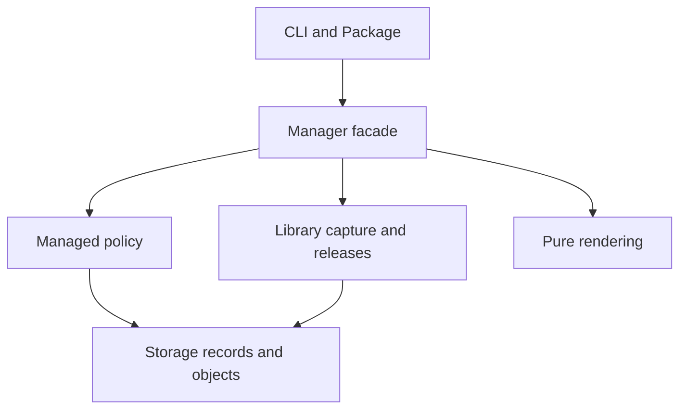

# Understand Prompt Manager ownership

Prompt Manager captures prompt content, preserves user choices, and renders
snapshots. The installed runtime uses only Python's standard library. Consumers
own acquisition, model execution, and application startup.

## Follow an operation

The public facade coordinates owners. The pure renderer receives snapshots and
inputs; it does not read publisher files or persist inputs.

## Find the change owner

| Reader task | Definition | Evidence |
| --- | --- | --- |
| Change input binding or composition | [prompts/composition.py](../src/prompt_manager/prompts/composition.py) | [Render tests](../tests/library/test_manager.py) |
| Change capture or releases | [library/snapshots.py](../src/prompt_manager/library/snapshots.py) | [Stored compatibility](../tests/integration/test_stored_compatibility.py) |
| Change publisher activation | [managed/updates.py](../src/prompt_manager/managed/updates.py) | [Registration tests](../tests/sdk/test_registration.py) |
| Change merge decisions | [managed/reconciliation.py](../src/prompt_manager/managed/reconciliation.py) | [Managed tests](../tests/managed/test_managed.py) |
| Change organization/search | [managed/organization.py](../src/prompt_manager/managed/organization.py) | [Search tests](../tests/sdk/test_search.py) |
| Change source or logical selection | [applications/resolution.py](../src/prompt_manager/applications/resolution.py) | [Mapping tests](../tests/sdk/test_mappings.py) |
| Change storage/recovery | [storage/files.py](../src/prompt_manager/storage/files.py), [library/backup.py](../src/prompt_manager/library/backup.py) | [Process tests](../tests/storage/test_processes.py), [backup tests](../tests/storage/test_backup.py) |

Domain workflows receive their actual dependencies and do not call back into
Manager. CLI handlers present public results; they do not implement update policy.
[Boundary tests](../tests/architecture/test_boundaries.py) enforce dependency
direction, runtime imports, and absence of facade injection/import cycles.

## Identify the retained state

| Area | Owner and meaning |
| --- | --- |
| `objects/`, `releases/` | Library/storage: immutable snapshots and pack/version labels |
| `managed/`, `managed-history/` | Managed policy: current pointer, baseline/upstream, immutable states |
| `sources/`, `applications/` | Registry: external locations and logical selections |
| `locks/` | Storage: cross-process writer coordination |

Managed commits publish content and history before replacing current state.
Failures can leave unreferenced artifacts or a complete new state visible; re-read
before retrying guarded writes. [Storage reliability](storage-reliability.md) owns
platform limits and audit semantics. External backend formats retain their own
maintenance responsibility.

## Choose the next task

[Own and reconcile](owned-prompts.md), [capture imports](imports.md),
[compose snapshots](rendering.md), or [integrate selections](integrations.md).
The retained [architecture reference](architecture.md) explains detailed module
boundaries, diagnostic conversion, metadata capture, and backup internals.
Use [development](development.md) before changing an owner.
