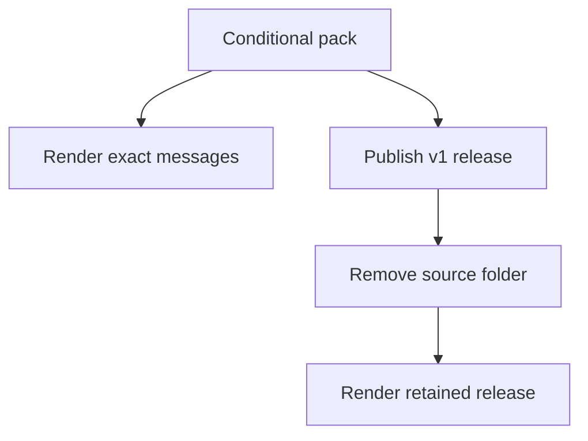

# Compose a conditional prompt pack

Check exact messages, literal documents, single-pass substitution, and immutable release rendering after source removal.

## Follow the SDK boundary



A release retains the selected prompt content so later rendering does not depend on the publisher folder. The excerpt below is from the runnable script; its setup and surrounding checks remain in that script.

```python
rendered = manager.render(source, {"task": "{{ untouched }}"}, prompt="review", format="messages")
assert rendered["output"] == [
    {"role": "system", "content": "Review {{ untouched }}."},
    {"role": "user", "content": "Literal {{ example }}."},
]
manager.release(source, "v1")
shutil.rmtree(source)
pinned = manager.render("conditional@v1/review", {"task": "parser", "guide": False}, format="messages")
assert pinned["output"] == [{"role": "system", "content": "Review parser."}]
assert [row["id"] for row in pinned["sections"] if row["included"]] == ["task"]
assert manager.check_store()["ok"]
```

Continue with [a captured prompt that survives library changes](../../../docs/examples/connected/frozen-prompt.md) to connect this boundary to Carrier delivery, Undercurrent execution and a checked application result.

## Run the example

Use Python 3.11+ with Prompt Manager installed. From the package directory:

```sh
python examples/compose_pack.py
```

Download or inspect [compose_pack.py](../../examples/compose_pack.py). The script creates only temporary
local files, performs no network/model work, and cleans up when it exits.
A failed assertion or operation exits nonzero.

Expected final output:

```text
PASS: conditions, literal documents, single-pass substitution, and source-free release
```

## Inspect the behavior

The saved pack example checks the omitted guide. The script separately checks
that document braces remain literal and substituted input is not evaluated twice.
After publication, deleting the source does not prevent release rendering.

See [rendering](../rendering.md), [format](../FORMAT.md), and
[composition tests](../../tests/library/test_manager.py).
