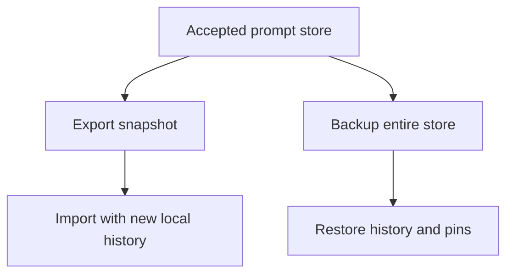

# Transfer snapshots and recover full history

Verify the difference between portable accepted content and full-store recovery.

## Follow the SDK boundary



A snapshot transfers accepted content and starts new history; a store backup preserves the original recovery history. The excerpt below is from the runnable script; its setup and surrounding checks remain in that script.

```python
exported = root / "snapshot.json"
package.export(exported)
transferred = Manager(home=root / "transferred", packs=[])
transferred.import_local(exported, package_id="portable")
assert transferred.package("local", "portable").render("review")["output"] == package.render("review")["output"]
assert len(transferred.package("local", "portable").history()) == 1
```

Continue with [a queued task with a captured prompt](../../../docs/examples/connected/frozen-prompt.md) to connect this boundary to Carrier delivery, Undercurrent execution and a checked application result.

## Run the example

Use Python 3.11+ with Prompt Manager installed. From the package directory:

```sh
python examples/owned_workflow.py
```

Download or inspect [owned_workflow.py](../../examples/owned_workflow.py). The script creates only temporary
local files, performs no network/model work, and cleans up when it exits.
A failed assertion or operation exits nonzero.

Expected final output:

```text
PASS: snapshot transfer starts history; backup restores history, pins, and tags
```

## Inspect the behavior

Snapshot export/import captures accepted content and starts a new local history.
Backup/restore preserves complete original history, tags, and historical pins.
The restore target does not exist before the operation. A new package handle binds
to the restored home; serialized references are not silently rebound.

See [imports](../imports.md), [search](../search.md), and
[backup/restore](../backup-restore.md).
