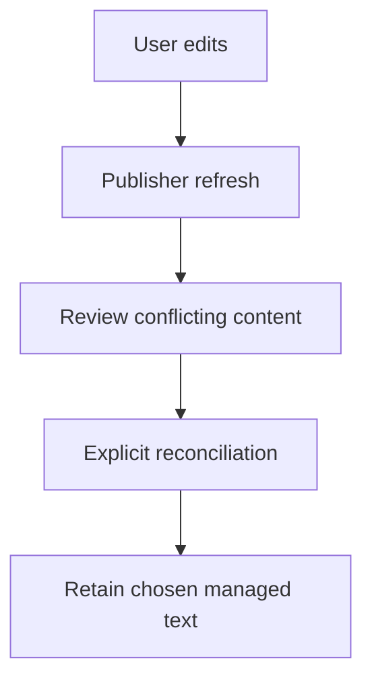

# Review a customized publisher update

Keep user edits active, reject a stale write, reconcile explicitly, and retain content after failed ingestion.

## Follow the SDK boundary



A publisher refresh exposes conflicting incoming content for review while the accepted user customization remains active. The excerpt below is from the runnable script; its setup and surrounding checks remain in that script.

```python
pending = package.register(source, publisher_revision=2, prompt_id="review")
assert pending.status["outcome"] == "update_pending"
assert pending.status["reconciliation_required"]
assert "My instructions." in pending.content
preview = package.preview_reconciliation()
assert preview["conflicts"]
```

Continue with [a worker that uses its originally captured task](../../../docs/examples/connected/frozen-prompt.md) to connect this boundary to Carrier delivery, Undercurrent execution and a checked application result.

## Run the example

Use Python 3.11+ with Prompt Manager installed. From the package directory:

```sh
python examples/publisher_review.py
```

Download or inspect [publisher_review.py](../../examples/publisher_review.py). The script creates only temporary
local files, performs no network/model work, and cleans up when it exits.
A failed assertion or operation exits nonzero.

Expected final output:

```text
PASS: edits survive update review, stale writes, and failed ingestion
```

## Inspect the behavior

The incoming revision changes the same file as the user, producing a conflict.
The explicit decision keeps managed text and advances the publisher baseline.
Registration of a missing source returns verified accepted content with
`refresh_failed`; strict refresh would raise instead.

See [owned prompts](../owned-prompts.md) and
[registration tests](../../tests/sdk/test_registration.py).
