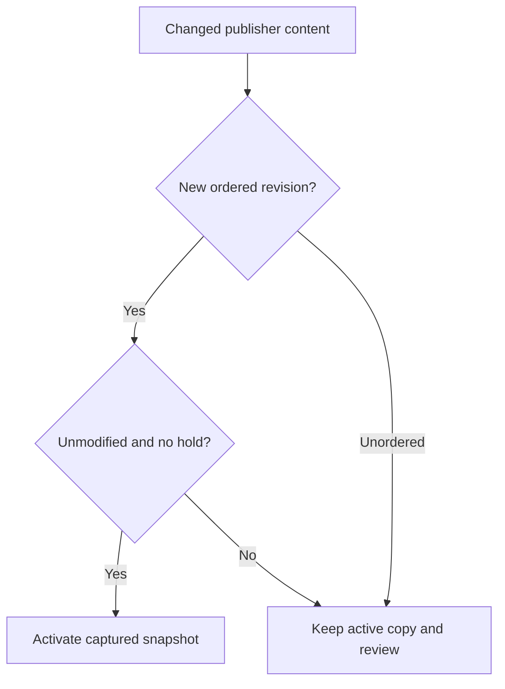

# Own prompts and review publisher changes

Owned content remains usable after publisher files disappear. Package handles bind
a publisher/package identity to one store without refreshing on construction.

## Owned imports and publisher updates

The following is an excerpt for an existing `manager` and native pack path:

```python
package = manager.package("publisher", "default")
result = package.register(
    "/absolute/path/to/bundled-pack", publisher_revision=12, version="1.4.0",
    prompt_id="review", inputs={"task": "Review the parser"},
)
content = result.content
status = result.status
```

Use the effective `content`, which can contain user edits. `status` describes the
same captured accepted revision. `register()` can retain verified usable content
when ingestion fails; initial failure, corrupt retained content, and invalid render
inputs still raise. `refresh()` and `ensure_registered()` strictly ingest without
rendering and raise on ingestion failure. Reopening a handle does not retry a source.

## Separate the identities

| Value | Purpose |
| --- | --- |
| Publisher/package IDs | Stable registration identity, independent of source path |
| Content digest | Snapshot equality and integrity |
| State `revision` | Guard mutations and pin immutable history |
| Integer `publisher_revision` | Order updates within this publisher/package |
| `version` | Display label; does not order updates |

This simplified decision view describes changed incoming content:



First registration imports and activates. Identical content is idempotent. Older
ordered revisions are ignored; reused revisions with different content conflict.
An ordered stream must keep supplying ordered revisions. Tracking disabled means
registration retains the accepted copy without ingesting the source.
The complete rules, including equality cases and legacy adoption, remain in
[the managed contract](MANAGED.md#update-policy) and
[updates.py](../src/prompt_manager/managed/updates.py).

## Edit and reconcile

Read the latest status before saving. Save accepts relative file paths mapped to
text, or null for deletion, including `pack.json`. The entire candidate snapshot
and saved rendering examples must validate before activation.

```python
observed = package.status()
package.save({"body.md": "My review instructions.\n"},
             expected_revision=observed["revision"])
preview = package.preview_reconciliation()
# Inspect conflicts and the candidate before choosing a side.
accepted = package.reconcile(expected_revision=preview["revision"], take="managed")
```

This excerpt assumes `body.md` belongs to the accepted pack. Keeping the managed
side still advances the publisher baseline, so the same update does not ask again.
Preview is read-only. Clean disjoint text edits can merge; unresolved conflicts,
stale tokens, and invalid candidates fail. Use individual JSON-pointer resolutions
when taking a whole side would lose useful changes. See
[editing and reconciliation](MANAGED.md#editing-and-reconciliation).

The [publisher example](examples/publisher-review.md) demonstrates an actual
conflict, guarded adoption, and retained content after a missing-source failure.

## History, pinning, and retained registrations

`package.history()` lists newest-first immutable states. `resolve()` and `render()`
accept `revision=STATE_TOKEN`. `restore(old_revision, expected_revision=current)`
creates a new active state from historical content and holds it against automatic
publisher advancement until reconciliation. Current labels, tags, and archive
settings survive content restoration.

`set_tracking(False, expected_revision=current)` retains content and stops
registration ingestion. Re-enable tracking explicitly before refreshing again.
Omitted registrations remain stored; automatic deletion and garbage collection
are not provided. `release(version, revision=...)` publishes a selected accepted
snapshot under the normal immutable pack-name/version rules.

`adopt_legacy()` preserves imported customization with an unknown ancestor.
Conflicting values require explicit choices until a known baseline is established.
See [migration contract](MANAGED.md#existing-consumers-and-migration) rather than
inventing an ancestor from the newest publisher copy.

## Find the implementation

[Registration](../src/prompt_manager/managed/registration.py) owns capture/failure
retention. [Reconciliation](../src/prompt_manager/managed/reconciliation.py) owns
review, and [history](../src/prompt_manager/managed/history.py) owns restoration.
[Registration tests](../tests/sdk/test_registration.py) and
[SDK workflow tests](../tests/sdk/test_sdk.py) exercise these paths.
