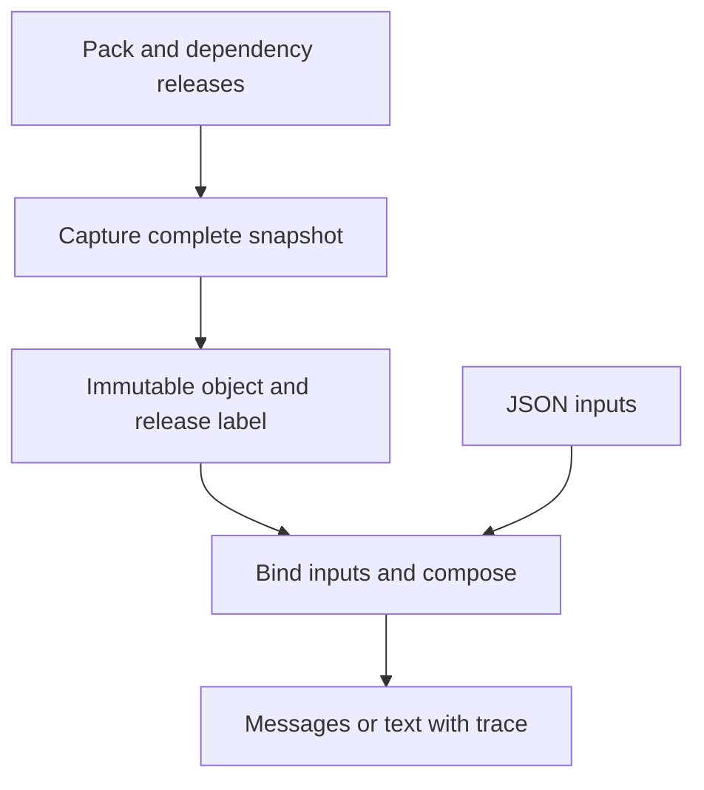

# Compose, render, and release prompt packs

Rendering transforms a captured snapshot and JSON inputs into text or ordered
role/content messages. It performs no model call and saves no raw-input history.

## Packs, templates, and releases

Run these commands from the package directory with an explicit tutorial store:

```sh
export PROMPT_MANAGER_HOME="$PWD/.prompt-manager"
prompt-manager release ./packs/common --version 1
prompt-manager validate ./packs/demo
prompt-manager render ./packs/demo --prompt review --inputs examples/inputs.json
prompt-manager release ./packs/demo --version 1
prompt-manager render demo@1/review --inputs examples/inputs.json --json
prompt-manager diff demo@1 ./packs/demo --prompt review --inputs examples/inputs.json
python examples/render.py
```

The existing [render.py](../examples/render.py) uses published `demo@1`; its input
values are embedded in the script. [inputs.json](../examples/inputs.json) is the CLI
input fixture. Identical publication is idempotent; a changed pack needs a new label.
These local content releases are separate from releasing Manager Suite software.

## Bind inputs before composition

Prompt inputs declare types, required values, defaults, and optional enums.
Bindings pass prompt values or literal values to section inputs. Sections substitute
`{{ name }}` for strings or `{{ value | json }}` for JSON values. Substitution is
single-pass: inserted text is not evaluated again. Documents remain literal.

Each ordered entry emits one message unless its typed `when` comparison excludes
it. Entries can set a role and heading. Sections do not recursively include other
sections; recipes express reuse through their ordered entries.
Definitions validate even when conditions omit an entry.
The [composition example](examples/compose-pack.md) builds a complete pack with
an optional literal document and checks exact messages.

## Capture immutable snapshots

This diagram separates capture, storage, and pure rendering:



A release embeds the pack and transitive dependency content. Rendering does not
resolve dependency labels again or read original directories. Changes to manifest,
assets, saved examples, or embedded dependencies change the digest. Labels are
immutable references; digests detect equality/corruption and are not signatures.

## Check rendering evidence

`validate` and `release` run saved examples; ordinary rendering validates definitions
and actual inputs without rerunning every example. A pack can have zero examples.
Saved expectations check composition/output, not model quality.

Text output uses `[role]` markers, blank lines between messages, and a final newline
when messages exist. Messages output preserves order and role/content pairs.
Result provenance includes input/output digests, renderer, snapshot identity,
dependencies, and included/omitted section trace. Empty composition yields `[]` or
empty text. See [exact format and digest rules](FORMAT.md#output-and-identity).

The authoritative [format](FORMAT.md), [rendering implementation](../src/prompt_manager/prompts/rendering.py),
[composition implementation](../src/prompt_manager/prompts/composition.py), and
[behavior tests](../tests/library/test_manager.py) own the detailed contracts.
