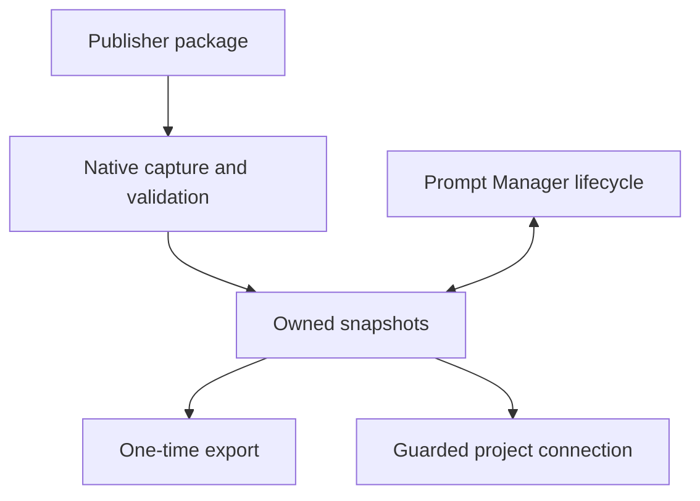

# Architecture and ownership

Use this map to locate the owner before changing registration, reconciliation,
or delivery behavior. Skill Manager stores native packages; it never runs their scripts.

A publisher refresh and a project update are separate decisions. Pending publisher
content does not replace customized accepted content. Project previews pin accepted
content; applying a plan does not substitute a later library revision.

## Find the implementation owner

| Boundary | Owner and source | Evidence |
| --- | --- | --- |
| Public handles and captured resolutions | [SDK](../src/skill_manager/sdk.py) | [SDK tests](../tests/test_sdk.py) |
| Native bytes, paths, metadata, manifests | [Capture](../src/skill_manager/fs.py), [metadata](../src/skill_manager/metadata.py) | [Manager tests](../tests/test_manager.py) |
| Lifecycle backend and binary atomic values | [Backend](../src/skill_manager/managed.py) | [Managed tests](../tests/test_managed.py) |
| Accepted-state policy and review | Prompt Manager public SDK through [adapter](../src/skill_manager/_managed.py) | [Integration tests](../tests/test_prompt_integration.py) |
| GitHub acquisition policy and retained jobs | [Sources](../src/skill_manager/sources.py), [jobs](../src/skill_manager/source_jobs.py) | [Source tests](../tests/test_sources.py) |
| Project plans, ownership and recovery | [Projects](../src/skill_manager/projects.py) | [Project tests](../tests/test_projects.py) |
| Immutable objects and byte blobs | [Store](../src/skill_manager/store.py) | [Storage contract](storage.md) |

Prompt Manager does not import Skill Manager. Skill Manager retains its native
schemas, release namespace, and filesystem delivery. Shared filesystem utilities
supply locking and Windows path protection; optional GitHub acquisition uses the
independent GitHub source library. Installed operation needs no suite checkout.

## Choose the right identity

| Selection | Meaning |
| --- | --- |
| External draft entry ID | Store, source, and canonical authoring directory |
| `SkillReference` | Store plus stable publisher/skill IDs; no selected revision |
| `ResolvedSkill.revision` | Exact accepted historical state |
| Package digest | Complete manifest identity, including bytes, flags, and directories |
| `source/name@version` | Immutable published label |
| Project plan | Sealed observations and selected accepted content |

Use a captured resolution when inspection and delivery must select the same state.
Use [project connections](project-delivery.md) when tracking installed content matters;
use [export](native-format.md#export-without-overwriting) for an untracked copy.
