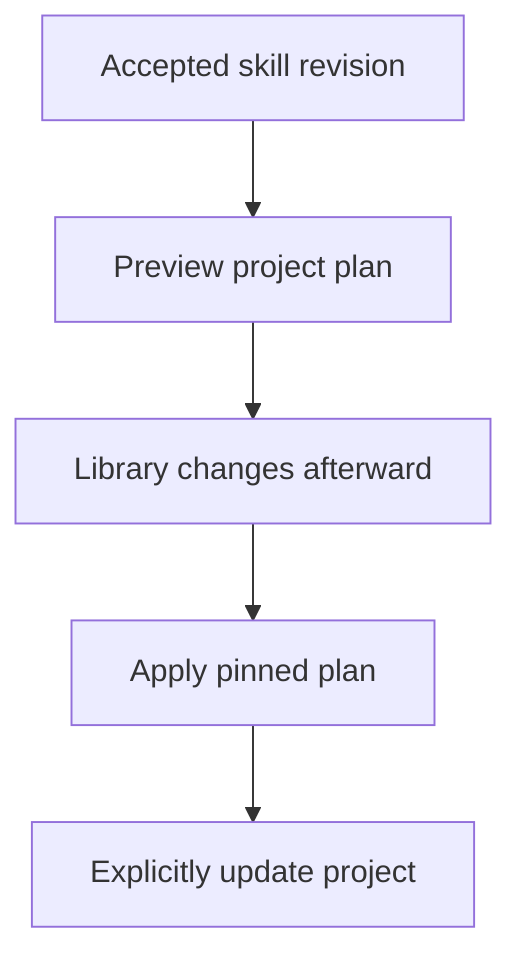

# Connect, update, and detach a project skill

Verify pinned project plans and delivery of text, binary, executable, and empty-directory content.

## Follow the SDK boundary



A preview pins the selected revision, so applying it does not silently include later library edits. The excerpt below is from the runnable script; its setup and surrounding checks remain in that script.

```python
plan = project.preview_connect([skill.reference], skills_dir="skills")
assert not (project_root / ".skill-manager").exists()
skill.save({"notes.md": FileContent(b"Check failure paths.\n")},
           expected_revision=captured.revision)
receipt = project.connect(json.loads(json.dumps(plan)))
assert receipt["status"] == "completed"
```

Continue with [a reviewed skill rollout through a worker inbox](../../../docs/examples/connected/skill-rollout.md) to connect this boundary to Carrier delivery, Undercurrent execution and a checked application result.

## Run the example

Use Python 3.11+ with Skill Manager and its declared dependencies installed.
From the package directory:

```sh
python -B examples/project_connection.py
```

The [complete runnable source](../../examples/project_connection.py) creates its working files in a temporary
directory. Assertions verify the resulting files and state; a failed assertion or
exception exits unsuccessfully. Normal exit removes the fixture automatically.
No scripts from the skill package are executed and no provider is contacted.

The JSON result includes `status: "completed"`, `preview_pinned: true`,
`binary_preserved: true`, and `detached: true`. The first apply installs the
previewed revision even after a library edit. An explicit update adds `notes.md`.
Detach removes the unchanged installed directory; owned library bytes remain readable.

[Project connections](../project-delivery.md) explains edited destinations and recovery.
