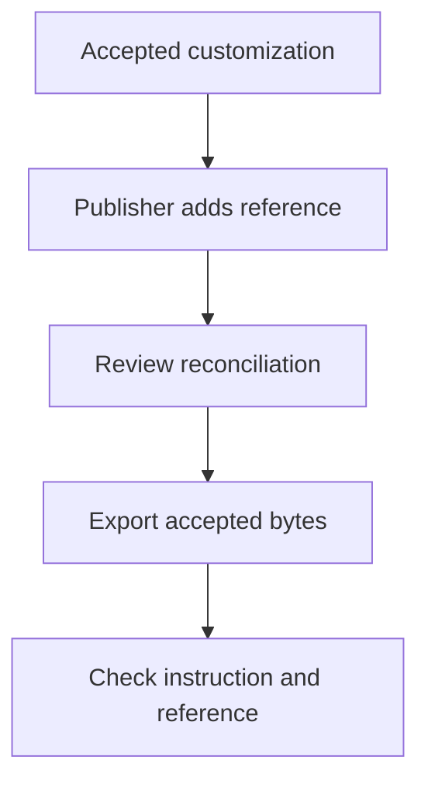

# Publisher update with user edits

Run a publisher refresh, preserve a user customization, reconcile, and verify exported instruction and reference bytes.

## Follow the SDK boundary



Registration exposes pending content; explicit reconciliation determines the accepted bytes exported to the consumer. The excerpt below is from the runnable script; its setup and surrounding checks remain in that script.

```python
pending = skill.register(publisher, publisher_revision=2)
assert pending.status["reconciliation_required"]
assert pending.content.read_file("SKILL.md") == customized

# An application shows this review. Here, assume the user approves it.
review = skill.preview_reconciliation()
assert review["valid"] and not review["conflicts"]
skill.reconcile(expected_revision=review["revision"])
accepted = skill.resolve()
destination = root / "consumer" / accepted.name
destination.parent.mkdir()
receipt = accepted.export(destination)
```

Continue with [a guarded skill update with real project delivery](../../../docs/examples/connected/skill-rollout.md) to connect this boundary to Carrier delivery, Undercurrent execution and a checked application result.

## Run the example

Use Python 3.11+ with Skill Manager and its declared dependencies installed.
From the package directory:

```sh
python -B examples/sdk_application.py
```

The [complete runnable source](../../examples/sdk_application.py) creates its working files in a temporary
directory. Assertions verify the resulting files and state; a failed assertion or
exception exits unsuccessfully. Normal exit removes the fixture automatically.
No scripts from the skill package are executed and no provider is contacted.

The JSON result includes `pending_review_seen: true` and `exported: "exported"`.
The user edit remains in exported `SKILL.md`; the publisher's new
`references/checks.md` is also present. Publisher instruction bytes stay unchanged.

[Registration and reconciliation](../owned-content.md) explains conflicts and stale guards.
