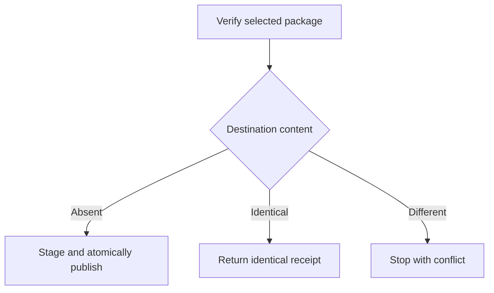

# Validate native packages and export exact content

Use native validation before publication, then export a captured selection to an
explicit consumer directory. Validation reads content; it never runs skill scripts.

## Keep the package identity intact

A native package contains `SKILL.md` and supporting files or directories. Frontmatter
requires `name` and `description`; the name matches the package directory basename.
Optional fields include license, compatibility, string metadata, and allowed-tools.
Unknown fields belong inside `metadata`. Safe YAML rejects duplicate keys, aliases,
anchors, and custom object tags.

The manifest captures raw file bytes, executable flags, metadata, and all supporting
directories, including empty directories and hidden regular files. Changing a script,
asset, executable flag, or directory changes the package digest. Export preserves
these native distinctions rather than flattening content into instructions.

| Constraint | Local implementation limit |
| --- | --- |
| Files and directories | 4,096 entries |
| One file / all file bytes | 64 MiB / 256 MiB |
| Path depth | 32 components |
| Path / component UTF-8 length | 4,096 / 255 bytes |
| Metadata inspection | 1 MiB of `SKILL.md` |
| Stored JSON record | 64 MiB |

These are implementation bounds, not additional Agent Skills specification rules.
Symlinks and special files are rejected. Portable paths reject traversal, absolute
paths, reserved Windows components, and case or Unicode normalization collisions.
See the [full native reference](native-authoring.md#format-release-and-export-contract)
for permissions, platform support, and containment details.

## Choose a delivery selection

| Need | Selection |
| --- | --- |
| Edit a registered external directory | Catalog entry ID plus observed draft digest |
| Keep inspection and delivery on one accepted state | Captured `ResolvedSkill` |
| Retain a published integration binding | Immutable `source/name@version` |
| Track installation and later updates | [Project connection](project-delivery.md) |

Release labels cannot be rebound. Repeating publication with the same label and
content returns the original record. Resolution verifies stored objects and blobs;
it does not depend on the publisher directory still existing.

## Export without overwriting

This excerpt assumes an accepted `skill` handle and an existing caller-owned parent:

```python
resolved = skill.resolve()
receipt = resolved.export("/existing/consumer/" + resolved.name)
assert receipt["status"] in {"exported", "identical"}
```



The destination basename must equal the native package name. Export does not merge
or overwrite. Unsupported no-replace publication fails instead of falling back to
copying over existing content. The receipt proves delivery of that selection;
it does not prove provider activation.

For external draft creation, repair digests, CLI commands, and the retained CSV
fixture, use [native authoring](native-authoring.md). Inspect [capture](../src/skill_manager/fs.py),
[metadata parsing](../src/skill_manager/metadata.py), and [Manager tests](../tests/test_manager.py)
when changing this contract.
