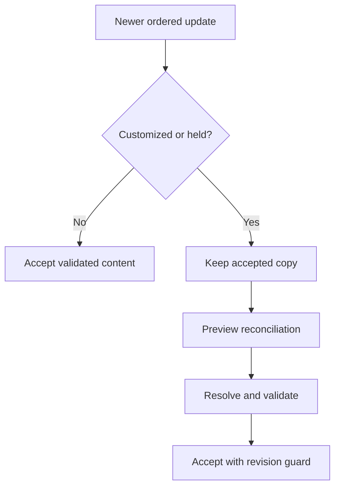

# Maintain owned skill content

Register an application bundle once, then preserve user changes while reviewing
publisher updates. Skill Manager captures the complete validated package into its
own store. Removing the publisher directory does not remove accepted content.

## Register and edit

Use stable publisher and skill IDs; they need not match the native package name.
The following excerpt assumes `publisher_path` names a valid native skill directory:

```python
from skill_manager import FileContent, Manager

manager = Manager(home="/absolute/skill-store")
skill = manager.skill("example-app", "review")
registered = skill.register(publisher_path, publisher_revision=1)
current = registered.content
skill.save(
    {"references/checks.md": FileContent(b"Check failure paths.\n")},
    expected_revision=current.revision,
)
```

Saving validates the complete candidate and rejects stale revisions. File values
contain bytes and an explicit executable flag; `None` deletes a file. Incomplete
editor buffers must stay outside accepted storage. Managed operations never edit
publisher files or execute package scripts.

## Decide what an update changes

Publisher revisions order observations; version strings are descriptive labels.
The accepted snapshot remains usable while review is pending.



| Observation | Result |
| --- | --- |
| Same package content | Keep accepted state without an unnecessary revision |
| Older ordered revision | Ignore downgrade |
| Reused revision, changed content | Reject refresh; registration can retain a verified copy |
| Changed unordered content | Require review |
| Failed registration with usable content | Return retained content and sync diagnostics |
| Failed first registration or strict `refresh()` | Raise `SkillError` |

Surface both pending review and `sync_error` to consumers. A notification dismissal
does not accept incoming content.

## Review, accept, or retain

```python
review = skill.preview_reconciliation()
# Display the proposal and conflicts before making this decision.
accepted = skill.reconcile(
    expected_revision=review["revision"], take="managed",
)
```

`take="managed"` retains user content and advances the publisher baseline, so the
same update does not reopen review. `take="publisher"` selects incoming content.
Per-conflict choices support managed, publisher, baseline, explicit value, or deletion.
Disjoint text edits can merge; binary conflicts require choices. Every result must
validate, and stale reviews fail.

Use `history()` and guarded `rollback()` to restore accepted content. Rollback holds
that content against automatic publisher advancement. Tracking can be paused without
losing the owned copy. See the [complete lifecycle reference](managed.md) for CLI,
legacy adoption, conflict pointers, and immutable release consumers.

Run the [publisher update example](examples/publisher-update.md) for verified working
files and export outcomes. Ownership lives in the [native backend](../src/skill_manager/managed.py)
and public lifecycle adapter; [managed tests](../tests/test_managed.py) exercise
customization, binary conflicts, and retained content.
