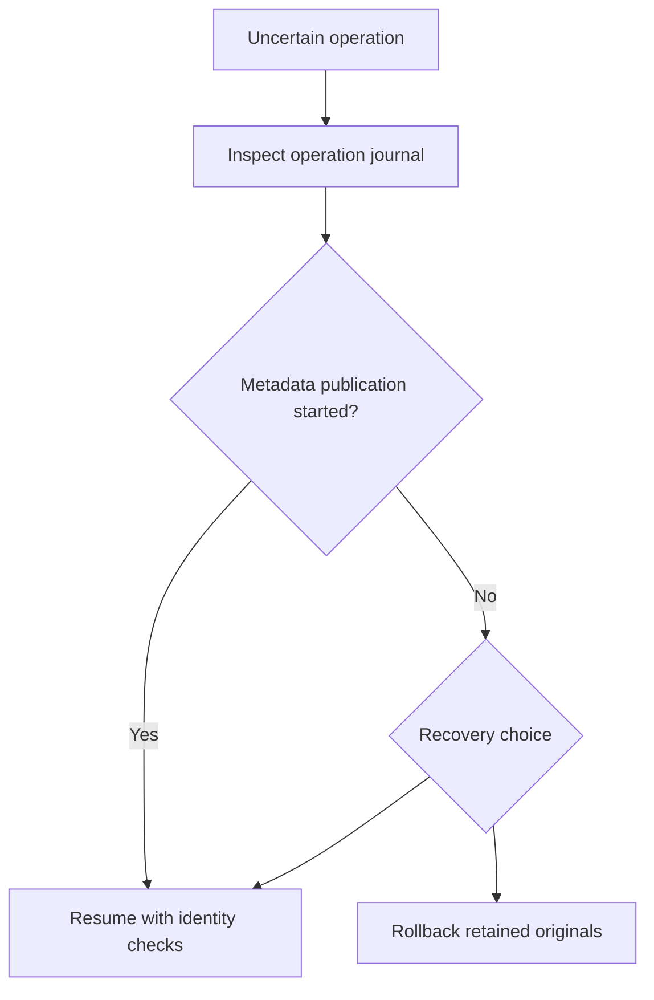

# Preview and deliver project skills

Connect accepted library content to an explicitly chosen project directory. Publisher
reconciliation and project updates are separate decisions. No running agent reload
or provider activation is implied.

## Preview and apply

Use an existing project and a registered skill. From the package's Python environment:

```python
project = manager.project("/absolute/project")
plan = project.preview_connect([skill.reference], skills_dir="skills")
# Inspect the complete plan before applying it unchanged.
receipt = project.connect(plan)
assert receipt["status"] == "completed"
```

Preview persists a sealed plan in the manager store but does not write project files.
It pins accepted content at preview time, even when the selector is an older resolved
handle. Apply checks store/project identity, destination observations, and ownership.
Serialize all plan fields unchanged; altered or stale plans fail. Reapplying the same
plan returns its original operation receipt.

The destination must be a portable relative project path. Skill Manager never guesses
an agent directory. Native package names determine destination basenames. Existing
unrelated directories conflict; explicit adoption accepts only identical packages.

## Update or detach

| Reader task | SDK choice | Guard or effect |
| --- | --- | --- |
| Inspect installed state | `project.connections()` | Shows edits, missing content, and available updates |
| Select newer accepted content | `preview_update()` then `apply_update(plan)` | Does not fetch publisher content |
| Remove unchanged owned copies | `preview_disconnect([skill.reference])` then `apply(plan)` | Retains recovery bytes |
| Drop ownership, keep files | `disconnect([skill.reference], forget=True)` | Explicit selection required |
| Restore recorded content | `apply(preview_restore())` | Exact local content; no fetching |

Updates and ordinary disconnects stop on project edits. Preserve an edited package
with guarded `save_variant()`, then forget the old connection and explicitly adopt
the variant. This does not update the shared original or automatically rebind it.
The [project reference](projects.md#preserve-project-specific-edits) gives exact guards.

## Recover an interrupted apply



Inspect `project.operations()` and the error's operation ID before retrying. Call
`project.recover(id, action="resume")` or `action="rollback"` explicitly. Pending
operations block mutations across stores. Competing or newly edited directories can
require manual review; recovery never silently discards edits.

The portable `.skill-manager/project.json` records identities, digests, and relative
destinations. Local receipts, locks, stages, and journals are separate recovery data;
keep them out of version control and retain pending recovery files. No transaction
spans multiple skill directories. Atomic moves may briefly leave a target absent.

Run the [project example](examples/project-connection.md) to verify pinned delivery,
whole-file fidelity, update, and detach. See [implementation](../src/skill_manager/projects.py),
[interruption tests](../tests/test_projects.py), and the [full project reference](projects.md).
